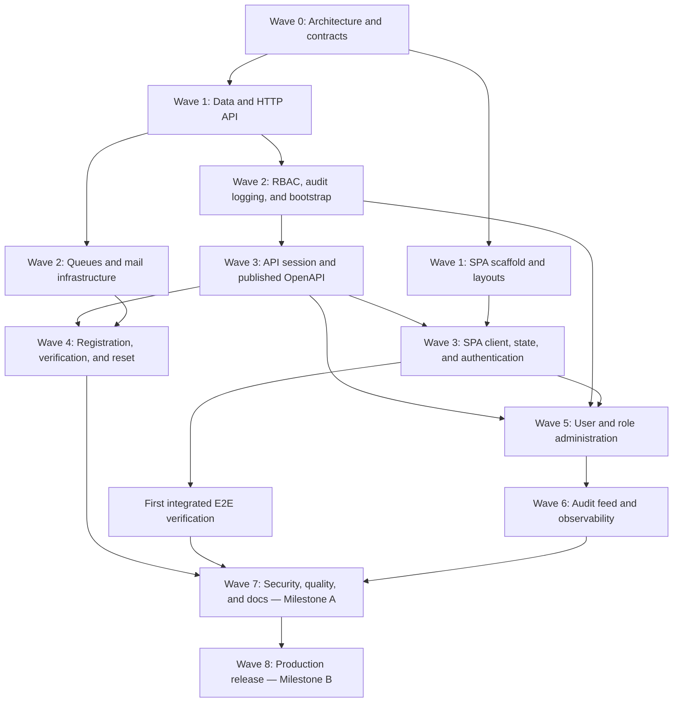

# Execution Roadmap — API and SPA

This roadmap defines the dependency-ordered delivery plan across the API and SPA repositories. It serves to coordinate execution across agents using CSD, from initial foundations through production operation. Tasks are sequenced strictly by dependency relationships.

Technical complexity and decompositions represent engineering estimates. Intended deliveries derive routing depth and required context from canonical classification.

## 1. Intake and Dependency Rules

Decisions preserved across all delivery tracks:

- API and SPA are independent repositories with independent deployments and versioning.
- Authentication uses first-party Laravel Sanctum session cookies and CSRF protection; no personal access tokens (PAT) or bearer tokens for SPA login.
- Public registration with automatic access activation after email verification. Unverified accounts receive a limited session for minimal profile, logout, and verification only; business routes remain denied.
- Explicit account deactivation blocks protected access even with an active session; verifying email does not reactivate an explicitly deactivated account.
- The initial administrator is promoted via a restricted operational command on an explicitly selected, verified account; execution is transactional, idempotent, and audited.
- CPF is optional for cadastral identification: normalized to 11 digits, validated for format and check digits, unique when provided. Read access is restricted to the subject and authorized management; never exposed publicly or captured in audit logs.
- Activitylog v5 writes allowlisted action codes with a minimal property envelope and 90-day retention. Failure to record audit logs rolls back privileged mutations.
- The legacy codebase is strictly a read-only reference; domain rules and texts are feature-driven rather than reused automatically.

## 2. Complexity Scale

| Scale | Interpretation | Distribution Strategy |
| --- | --- | --- |
| S | Small scope, clear boundary, few dependencies | Single executor; concise evidence-based review. |
| M | Bounded integration or cross-cutting configuration with tests | Single executor and independent reviewer; split into subtasks if touching shared files. |
| L | Security, migrations, state management, or cross-resource integration | Multiple CSD subtasks; dedicated integration owner and independent review. |
| XL | Undefined infrastructure or multi-environment coordination | Decompose before implementation; human decisions and operational evidence per stage. |

The complexity scale does not represent calendar days or hours. Risk and complexity are evaluated separately: authentication and personal data require sensitive security classification even when an individual subtask is small. Each work item derives its effective routing via CSD classification rules.

## 3. Wave-based Execution

Execution proceeds one wave at a time under an orchestrator coordinating defined subagent roles. Within an active wave, independent tasks may proceed in parallel once their dependencies are verified and integrated. A subsequent wave begins only after the current wave's quality and integration gates pass. Specification preparation may precede code, but does not authorize implementation of later waves. Progressive items deliver verified slices per wave.

### Wave 0 — Architecture and Contracts

| Delivery | Complexity | Dependencies and Verifiable Output |
| --- | --- | --- |
| Architecture and ADR review | M | Documented and accepted architectural decision records for API and SPA boundaries. |
| Initial contract review | L | Verified routes, schemas, states, cookies, and error response contracts. |
| Frontend baseline | M | Framework compatibility matrix, state management, CSS boundaries, and routing architecture. |
| Cross-repository quality gates | M / L | Defined repository quality checks, static analysis thresholds, and private OpenAPI exchange rules. |
| Threat modeling | L | Identified attack surfaces, security boundaries, and negative-acceptance criteria. |

**Gate:** Architectural decisions and contracts accepted before dependent implementation; baseline CI gates verified.

### Wave 1 — Executable Foundations

| Delivery | Complexity | Dependencies and Verifiable Output |
| --- | --- | --- |
| Identity data model | L | Users schema, verification and deactivation states, optional CPF constraints, and PostgreSQL isolation. |
| HTTP boundary | L | JSON error formatting, CORS policies, secure session cookies, CSRF validation, and rate limiting. |
| SPA application scaffold | M | TypeScript configuration, UI framework setup, client-side routing, and independent build pipeline. |
| SPA baseline quality gates | M | Linting, formatting, type checking, unit test harness, and build checks. |
| Core layouts and tokens | M | Public and authenticated layouts, responsive design, keyboard navigation, and theme tokens. |

**Gate:** Database migrations and factories executed in an isolated PostgreSQL test environment; HTTP error and cookie tests passing; SPA build and quality checks clean.

### Wave 2 — Operational Identity and Asynchronous Infrastructure

| Sequence | Delivery | Complexity | Verifiable Output |
| --- | --- | --- | --- |
| 1 | Operational command contract | M | Explicit account selection, authorization constraints, idempotency, and audit requirements. |
| 2 | RBAC schema and catalogue | L | Permission package integration, closed catalogue, idempotent seeders, and session guard alignment. |
| 3 | Minimal audit logging | L | Activitylog v5 integration, allowlisted event properties, transactional write, and failure rollback. |
| 4 | Initial administrator promotion | L | Operational command execution, verification requirements, concurrency safety, and audit recording. |
| 5 | Policies and authorization gates | L | Policy matrix enforcement, object-level access checks, administrative role protection, and deactivation checks. |
| 6 | Queues and local mail | L | Queue worker, scheduler, after-commit dispatch, retry and backoff handling, and local mail inspection. |
| 7 | Secure logging and health | M | Structured logs with correlation IDs, sensitive-data redaction, and application liveness checks. |

**Gate:** Complete database schema and idempotent seed execution; administrator bootstrap verified with atomic audit recording and rollback tests.

### Wave 3 — First End-to-End Journey: Session Authentication

| Sequence | Delivery | Complexity | Acceptance Criteria |
| --- | --- | --- | --- |
| 1 | API Session Authentication | L | Login, profile, and logout endpoints; session regeneration, CSRF verification, rate limiting, and failure statuses. |
| 2 | Generated and Published OpenAPI | L | Deterministic OpenAPI export from implemented controllers, versioned artifact publication, and compatibility gates. |
| 3 | Typed Frontend Client | M | Client types generated from the exact OpenAPI artifact, centralized credentials and CSRF handling. |
| 4 | Client State and Session | M | State stores for UI, server state query integration, profile retrieval after reload, and secure storage discipline. |
| 5 | Authentication Navigation | L / M | Asynchronous route guards, logout handling, permission-based navigation, and race-free session refresh. |
| 6 | Integrated E2E Verification | L | Browser-driven verification across running API and SPA services: login, profile reload, logout, and post-logout rejection. |

**Gate:** End-to-end browser journey succeeds against a real API instance; cookies, CORS, and CSRF protection proven.

### Wave 4 — Registration, Verification, and Password Recovery

| Delivery | Complexity | Dependencies and Verifiable Output |
| --- | --- | --- |
| Public registration and activation | L | Optional CPF validation, server-managed account state, signed verification links, token expiry, and automatic activation. |
| Password reset | L | Enumeration-safe responses, single-use reset tokens, rate limiting, SPA reset links, and post-commit notification dispatch. |
| Authentication screens | L | User interfaces for registration, email verification notice, password reset request, and reset completion. |
| Global application states | M | Dashboard shell, 403/404 handlers, expired-session interceptors, loading states, and network error handling. |

**Gate:** Email verification grants only standard profile access, never administrative privileges; email verification cannot reactivate an explicitly deactivated account; E2E flows with mail verification verified.

### Wave 5 — User and Role Administration

| Delivery | Complexity | Dependencies and Verifiable Output |
| --- | --- | --- |
| User management API | L | Requests, Resources, Policies, allowlisted filters and sorting, bounded pagination, restricted CPF access, and audited mutations. |
| Role management API | L | Catalogue inspection, role permission updates, custom role rename, administrative role protection, and escalation prevention. |
| User management SPA | L | Remote listing, filterable tables, pagination, form validation, and permission-gated action buttons. |
| Role management SPA | L | Grouped permission matrix, diff confirmation, and visual protection of built-in administrative roles. |

**Gate:** Server-side policies strictly enforced independently of UI permissions; verified protections against self-privilege escalation and mass assignment; transactional audit rollback verified.

### Wave 6 — Audit Query and Full Observability

| Delivery | Complexity | Dependencies and Verifiable Output |
| --- | --- | --- |
| Audit feed API | L | Gated `GET /api/v1/logs` endpoint, allowlisted property filtering, bounded pagination, and 90-day retention cleanup. |
| Audit inspection SPA | M | Audit table, structured filters, property diff viewer, and read-only display. |
| System observability | M / L | Application logs, readiness probes, and authorized operational monitoring where configured. |

**Gate:** Audit feed restricted to designated permissions; zero capture of credentials, passwords, or unapproved attributes; automated retention cleanup verified.

### Wave 7 — Milestone A: Functional and Documented Ecosystem

| Delivery | Complexity | Completion Evidence |
| --- | --- | --- |
| Integrated security review | L | Updated threat model against real flows; abuse, CSRF, CORS, fixation, enumeration, IDOR, and mass assignment tests. |
| Ecosystem quality consolidation | L / XL | All progressive gates executed; concurrency and negative-path tests verified; blocking CI gates confirmed. |
| Documentation and developer setup | M / L | Clean checkout reproduction across both repositories; verified setup commands, API contracts, and architecture guides. |

**Gate Milestone A:** Authentication, registration, verification, reset, RBAC, user management, audit logging, and frontend interfaces functional; automated tests and documentation complete. Milestone A does not require public production deployment.

### Wave 8 — Milestone B: Production Release and Recovery

| Sequence | Delivery | Complexity | Completion Evidence |
| --- | --- | --- | --- |
| 1 | Operational decisions | XL | Production infrastructure, domains, TLS termination, CORS origins, secrets management, and rollback triggers defined. |
| 2 | Production API image | L | Minimal production container without development dependencies, immutable digest pinning, and migration safety. |
| 3 | Independent API deployment | XL | Staging verification, release approval, smoke testing, and documented rollback execution. |
| 4 | Independent SPA deployment | L | Immutable static build, preview validation, client routing configuration, zero bundled secrets, and rollback execution. |

**Gate Milestone B:** Independent releases, deployment to target environments, verification during the observation window, and validated recovery procedures.

## 4. Continuous Tracks

The following engineering activities accompany every wave and feature:

| Track | Baseline | Continuous Requirement |
| --- | --- | --- |
| Automated testing | Project scaffold | Every migration, account state, policy, and endpoint adds focused behavioral and isolation tests. |
| Continuous Integration | CI workflows | Workflows execute quality gates, contract freshness, and security checks on every change. |
| Application security | Wave 0 threat model | Abuse tests, parameter tampering checks, and sensitive data protection verified per feature slice. |
| Frontend testing | SPA test harness | Component tests, mocked network tests, and interface assertions evolve alongside each feature. |
| End-to-end validation | Integration harness | Multi-step user journeys execute against isolated API and frontend environments. |
| Contract synchronization | OpenAPI producer | Endpoints update the versioned OpenAPI specification, verify compatibility, and regenerate client types. |
| Living documentation | Project documentation | Guides, commands, contract documentation, and architectural decisions update within the feature change. |

## 5. Multi-agent Role Distribution

| Role | Core Responsibility | Evidence Delivered |
| --- | --- | --- |
| Architecture & Planning | Specifications, dependency analysis, data modeling, and contract boundaries | Wave plan and subtasks with acceptance criteria and editing boundaries |
| Backend Engineering | Migrations, identity, HTTP layer, RBAC, domain actions, and audit logging | Code diff, migrations, and test results |
| Frontend Engineering | Application scaffold, UI layouts, client state, and responsive views | Code diff, consumed contract types, and component tests |
| Contracts & Integration | Generated OpenAPI artifacts, compatibility validation, and type synchronization | Versioned contract artifacts and integration verification |
| Quality & Verification | Independent gate validation, regression suites, and integrated E2E testing | Verification reports with executed commands and observed results |
| Security & Privacy | Threat modeling, authorization audits, input validation, and data redaction | Security test findings and residual risk documentation |
| Infrastructure & DevOps | Container configuration, asynchronous queues, CI workflows, and release automation | Operational gate results, smoke test logs, and deployment evidence |
| Documentation & CSD | Work-item maintenance, decision records, onboarding validation, and durable handoffs | Validated context artifacts and reproducible commands |

Shared integration files (such as dependency manifests, migration sequences, global routes, container configurations, and OpenAPI specifications) are coordinated by a single integration owner per wave.

## 6. CSD Delivery Protocol

1. Confirm repository, issue, current status, base branch, and prerequisites. Work-item IDs are local to each repository.
2. Follow the CSD front door: inspect the request, classify track and type, derive routing depth, build the minimal context manifest, and open or reference the local work item.
3. Review relevant architectural decisions and contracts. Documented and approved context records govern implementation boundaries.
4. Define concrete acceptance criteria, out-of-scope boundaries, dependencies, and questions in work-item artifacts. Establish permission names and contracts before implementing consuming code.
5. Decompose the plan into small subtasks and dependency-safe waves with explicit ownership and verification commands.
6. Implement strictly within the assigned task boundaries. Test using isolated services and appropriate runtime configurations.
7. Record commands, observed results, diff summaries, and independent review evidence.
8. Update affected contracts, generated types, CI configurations, and documentation within the same change.
9. Deliver via the authorized Git route (direct integration for low-impact documentation/tooling when permitted; pull requests for application code, migrations, security, and infrastructure).
10. Update work-item status and tracking upon integration into the target branch.
