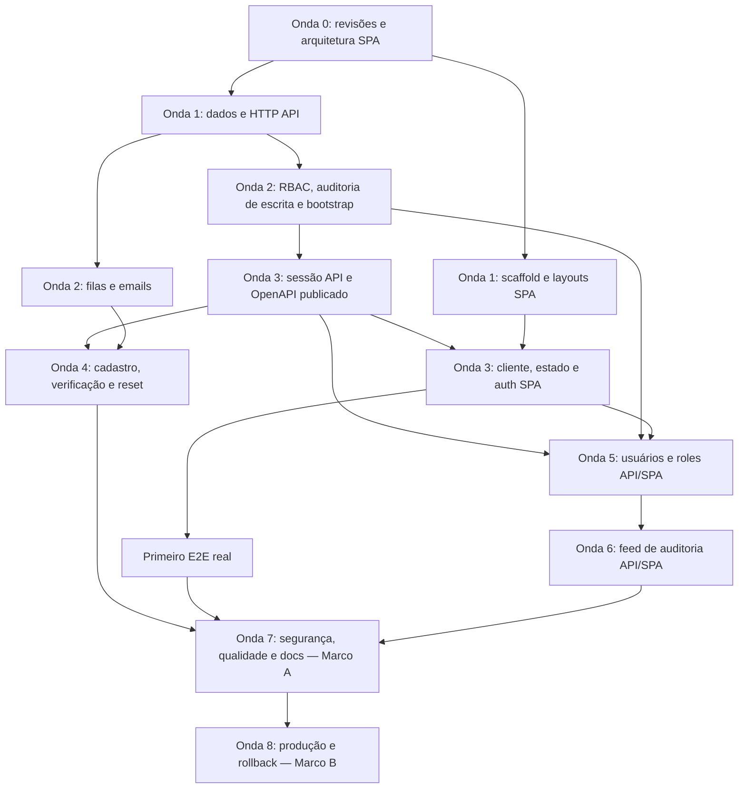

# Roadmap de execução — API e SPA

Este roteiro cobre os 47 itens do [quadro Starter Kit](https://github.com/users/yanpenalva/projects/1/views/1): 27 da API e 20 da SPA. Serve para distribuir entregas entre modelos usando CSD, do estado atual até operação em produção. A ordem é por dependências, não pela numeração das issues.

**Referência:** quadro consultado em 2026-10-02, America/Sao_Paulo. Status são uma fotografia; confirme-os antes de iniciar uma entrega. Complexidades e decomposições abaixo são estimativas técnicas deste planejamento, não valores preenchidos no quadro. Este documento não altera issues, status nem aprova contratos pendentes.

**Atualização humana posterior (confirmada por evidência em 2026-10-03):** yanpenalva informou o fechamento das tasks API #2/#3 na PR e a evidência remota confirma: [PR #30](https://github.com/yanpenalva/starter-kit-api/pull/30) merged em 2026-10-02T23:34:49Z (head 99321a9, merge 1d45f75), checks context/application/GitGuardian com sucesso no head e CI de `main` context/application SUCCESS. Essas entregas são **Done**; a fotografia de 2026-10-02 abaixo é histórica e não deve provocar reabertura ou nova execução. Em 2026-10-03 o usuário também aprovou o pacote de arquitetura SPA ("Aprovar pacote SPA": ADR de FEAT-1 + matriz; materialização no frontend em curso, não integrada) e a [política de transporte privado do OpenAPI](api.md) ("Aprovar transporte"); essas decisões não são reabertas. A escolha de Oh My OpenCode para coordenar os agentes também foi explicitamente informada; instalação e funcionamento desse harness ainda não foram verificados. Revisão independente inicial do orquestrador (2026-10-03): **PASS**, condicionada à formalização de [EXC-0001](../exceptions/EXC-0001.json) — cumprida; o registro antigo de preflight "revisor independente NOT FOUND" fica superseded e nenhuma revisão formal do GitHub foi fabricada. Kickoff da wave 0 registrado em [FEAT-6 handoff](../work/FEAT-6/handoff.md) e evidenciado em [FEAT-6 verification](../work/FEAT-6/verification.md) (o diário progress.md é local e ignorado pelo Git; não é publicado).

**Reconciliação operacional após integração da SPA (2026-10-03):** SPA #1 está fechada e Done no quadro. PR #22 integrada em `main` no SHA `86bf3d0efa715fca1edd5105add6bd5206c1bf92`; validação CSD estrita e seis testes Python passaram na revisão integrada. [Registro do orquestrador](https://github.com/yanpenalva/starter-kit-frontend/issues/1#issuecomment-5971166151). Total atual: **8/47 Done**. Menções anteriores a materialização/integração SPA pendentes são snapshots superseded por esta evidência. O gate global da wave 0 ainda aguarda revisão e integração da entrega documental da API.

**Gate da wave 0 ACEITO — wave 1 ativa (2026-10-03T18:35:08Z):** API [PR #31](https://github.com/yanpenalva/starter-kit-api/pull/31) merged (head `c726dfc`, merge `398a952`; PR checks context/application/GitGuardian ALL SUCCESS; `main` context/application SUCCESS, run 37144751065); frontend PR #22/#23 merged (`main` `42f235ce`); strict + testes limpos no main integrado (execução do pai). Board: 8/47 Done; API #9/#10 e SPA #2 In progress; API #4/#6/#22/#24 restauradas In progress. Fase atual: planejamento CSD de [FEAT-9](../work/FEAT-9/spec.md) e [FEAT-10](../work/FEAT-10/spec.md) na branch `feat/wave-1-api-foundations` (base 398a952); o catálogo da seção 8 permanece como está.

**Reconciliação da onda 2 (2026-10-04) — gate PENDENTE do seed default; onda 3 NÃO liberada:** onda 1 foi concluída e integrada (API PR #32 merge `065ff90`; checkpoint em [FEAT-6/checkpoint-wave-1.md](../work/FEAT-6/checkpoint-wave-1.md)) e as duas frentes da onda 2 foram integradas: identidade/auditoria [PR #33](https://github.com/yanpenalva/starter-kit-api/pull/33) (merge `4f7c74d`, CI `main` SUCCESS) e infra assíncrona [PR #34](https://github.com/yanpenalva/starter-kit-api/pull/34) (head `08009f7`, merge **`44aa89a29dbda6a16164014c914cc3b411324186`**; CI `main` no merge **SUCCESS**, run [37211538628](https://github.com/yanpenalva/starter-kit-api/actions/runs/37211538628) — context/application, 53 testes/248 assertions sem exclusões; merge da PR #34 sob autorização humana específica e excepcional do owner com o check externo GitGuardian `Triggered` (incidente 37826025), decisão formal em [FEAT-20 approval](../work/FEAT-20/approval.md), sem alegar check verde e sem estender [EXC-0001](../exceptions/EXC-0001.json) ou dispensar checks futuros). **Snapshot Done: 11/47** (fonte: estado das issues verificado em 2026-10-04 — API #12, SPA #5 e SPA #6 fechadas desde o snapshot de 8/47; as demais permanecem abertas como itens progressivos). Evidências já provadas do gate da onda 2: seeders do catálogo RBAC idempotentes e bootstrap/RBAC com escrita de auditoria atômica e rollback (`RbacCatalogueTest`, `PrivilegeFoundationTest`), infra async #20 e fatia de logs #21 integradas ([FEAT-20](../work/FEAT-20/verification.md) encerrado; issue #20 aberta — consumidores #14/#15 na onda 4). **Critério ainda não demonstrado: seed idempotente no caminho default** (`migrate:fresh --seed` executado duas vezes, exigência da issue #9): `main` @ `44aa89a` não contém `database/seeders/DatabaseSeeder.php` (evidência explorer, confirmada na worktree). **Atualização (2026-10-04, consolidação):** o gap foi implementado e validado localmente pela lane seed (`fix/wave-2-default-seeder`, commit fonte `2445e44`: DatabaseSeeder + teste exclusivo; relato do executor — PHP 8.5/PG 18 isolado: Pest 55 passed/266 assertions, Pint 60 files, Larastan 10 limpo, `migrate:fresh --seed` 2× standalone com catálogo 8 permissions/2 roles/**0 users**/0 assignments) e consolidado via cherry-pick na branch de gate `docs/wave-2-gate` (`2399fde`), com revisão independente em andamento. **A promoção do gate da onda 2 — e a liberação da onda 3 — seguem AGUARDANDO a integração (CI final no SHA consolidado) e o merge pelo parent; nada foi liberado antecipadamente.** **Correção de revisão (2026-10-04, pós-consolidação):** a re-review da fonte `2445e44` retornou **FAIL** — o processo-filho do teste mescla `DB_URL` herdada do ambiente (URL pode sobrepor `DB_DATABASE`/destino) e o guard de config não prova o banco alvo; exigências: `DB_URL => null` no env do filho, `assertNull` de `database.pgsql.url` no setup e guard `TEST_TOKEN` contra execução paralela. **Merge da PR #35 absolutamente bloqueado** até a correção na lane seed + novo gate; follow-up agendado pelo parent. **Atualização (2026-10-04, consolidação 2):** a correção foi implementada pela lane seed (`f796ed32d5366d59c1686b69b9c5713491bd5b78`, 1 arquivo de teste — guardas de URL/paralelismo + 2 testes adversariais) e consolidada via cherry-pick `-x` como `5aa7380` em `docs/wave-2-gate` (codeeq provada); relato do executor da correção (fixer2): Pest **57 passed / 293 assertions**, Pint 60, Larastan 10, `migrate:fresh --seed` 2× standalone com **8 permissions / 2 roles / 0 users / 0 assignments** e precondições de guard. O FAIL acima permanece **histórico** (não é fingido como PASS). **Merge segue bloqueado até re-review independente (parent/cav, fonte + delta docs) PASS e CI no SHA final; onda 3 NÃO liberada.** **GATE DA ONDA 2 ACEITO (2026-10-04, final):** re-review independente (cav) **PASS** (fonte codeeq, 57/293); CI da PR #35 no head `aedac01` **3/3 success** (run `37214604864`); **merge normal da PR #35 pelo parent (EXC-0001, sem waiver de GitGuardian — check passou por si): `main` @ `5604bf5e6fbbdb2c043780c82580f1cabf26293d`; CI `main` no merge SUCCESS** (run [37215264091](https://github.com/yanpenalva/starter-kit-api/actions/runs/37215264091), context/application). Artefato: seeder default exclusivo do catálogo (8 permissions/2 roles/0 users/0 assignments — **nenhum admin/credencial default**; escopo testing). Snapshot Done permanece **11/47** (itens progressivos #9/#16/#19/#20/#21 seguem abertos por escopo; fechamento de issue = parent no aceite completo). **Onda 3: PRONTA para execução — ainda não iniciada** (nenhuma implementação alegada). Os parágrafos de status anteriores são snapshots históricos.

**Onda 3 — auth entregue e integrada (2026-10-04):** PR #37 merged normalmente pelo parent sob EXC-0001 em `main` `1390009d37f6a3493b21be7d83dbd32ae355d579` (head `2bcf108`, CI 3/3 success run 37228391106; CI de `main` success run 37229764954). Artefato: Sanctum SPA session auth (login, perfil, logout), CSRF/fixação/desativação/throttle provados com 89 testes e 572 assertions (smoke 1/60), índice `users_email_lower_unique` com `lower(btrim(...))`, sem PAT, sem reescrita de contas. Revisão independente GLM-Go FINAL PASS, sem aprovação GitHub fabricada. Snapshot Done atual: **11/47** — issues #9 e #13 permanecem abertas até o aceite do parent; aceitas, o placar iria a 13/47 após a integração deste PR documental. API #11 (OpenAPI) e SPA #7 (transporte) seguem in progress, sem Orval gerado, sem UI, sem E2E; onda 3 NÃO está concluída e o gate de navegador segue em progresso. Os snapshots anteriores acima ficam preservados como história datada.

## 1. Estado de partida

| Situação observada | Itens | Consequência |
| --- | --- | --- |
| Done | API #1, #2, #3, #5, #7, #8; SPA #1, #4 (8/47) | Reutilizar ADRs, CSD, inventário, convenções e scaffold. API #2/#3 cobrem entregas iniciais integradas na PR #30; publicação gerada permanece em API #11. SPA #1 cobre arquitetura documental aceita e integrada na PR #22, não implementação de aplicação. |
| In progress | API #4; API #6; API #22; API #24 | API #6: primeira fatia documental **produzida localmente (não commitada)**; revisão e integração pendentes; transporte OpenAPI aprovado; issue **aberta**. API #4: definição inicial de gates. API #22: threat model inicial, testes de abuso por feature e consolidação na wave 7. API #24: CI inicial reconhecido, sem recriação. Movimentos do quadro efetuados pelo orquestrador. |
| Backlog | Demais itens | Preparar escopo CSD e verificar dependências antes de iniciar. |

A API tem scaffold Laravel 13/PHP 8.5, PostgreSQL 18, Docker Compose, Pint, Pest e Larastan **nível 10**, sem baseline. Só disponibilidade /api/v1 e health /up estão implementados. Autenticação, cadastro, CPF, RBAC e auditoria continuam pendentes. O estado do código da SPA deve ser inspecionado no seu próprio repositório; status no quadro não comprova runtime.

Decisões já aceitas, a preservar em todas as frentes:

- API e SPA independentes; Sanctum com sessão, cookies e CSRF, sem PAT no login SPA.
- Cadastro público e ativação automática após verificar email. Sessão limitada antes da verificação: perfil mínimo, logout e verificação; recursos de negócio negados.
- Desativação explícita bloqueia acesso protegido mesmo com sessão existente; verificar email não reativa essa conta.
- Primeiro administrador promovido por comando operacional restrito sobre conta explicitamente escolhida e verificada; operação idempotente e transacional.
- CPF opcional, normalizado, validado e único quando informado; leitura pelo titular e pela gestão com permissão específica.
- Activitylog v5, retenção de eventos por 90 dias, leitura autorizada e diffs por allowlist; CPF, email, credenciais, tokens e payload integral fora da auditoria.
- Falha ao auditar bootstrap ou alterações de privilégios reverte a operação.
- LDAP excluído. Legado apenas como referência estática; nenhuma cópia automática de regras, textos, dados ou credenciais.

Fontes: [arquitetura canônica](architecture.md), [ADRs](../../docs/adr/README.md), [aprovação original](../work/FEAT-1/approval.md), [sessão limitada aprovada](../work/FEAT-3/approval.md), [inventário](../work/FEAT-2/legacy-inventory.md) e [contrato inicial — convenções aceitas via PR #30](api.md). A aprovação da sessão limitada não equivale à aprovação de todo o contrato.

## 2. Escala de complexidade

| Escala | Interpretação | Forma de distribuir |
| --- | --- | --- |
| S | Escopo pequeno, um limite claro, poucas dependências | Um executor; revisão breve baseada em evidência. |
| M | Integração delimitada ou configuração transversal com testes | Um executor e um revisor; dividir em subtarefas se tocar arquivos compartilhados. |
| L | Segurança, migrações, estado ou integração entre recursos | Várias subtarefas CSD; responsável por integração e revisão independente. |
| XL | Infraestrutura ainda indefinida ou coordenação entre repositórios/ambientes | Decompor antes de implementar; decisões humanas e evidência operacional por etapa. |

A escala não representa dias nem horas. Risco e complexidade são distintos: autenticação e CPF exigem classificação de segurança sensível mesmo quando uma subtarefa é pequena. Cada work item deriva seu routing pelas regras do CSD; não converter S/M/L/XL diretamente em routing.

## 3. Como executar as ondas

O usuário escolheu execução organizada de uma wave por vez, sob um orquestrador único e subagentes com funções definidas. Dentro da wave ativa, uma frente começa assim que suas dependências estiverem verificadas e integradas; outras tarefas da mesma wave podem avançar em paralelo. A próxima wave só é liberada após o gate da atual. Preparação de especificação pode anteceder código, mas não libera implementação de waves posteriores. Itens progressivos têm aceite por fatia em cada wave e só são fechados quando seu escopo completo terminar.

O caminho principal é:



Testes, segurança, CI, documentação e atualização OpenAPI acompanham todas as ondas; a onda 7 consolida evidências, não inicia essas atividades.

### Onda 0 — liberar contratos e coordenação

| Entrega | Itens | Complexidade | Dependências e saída verificável |
| --- | --- | --- | --- |
| Revisar inventário | API #2 | M | Conferir referências no commit fixado do legado e disposições greenfield; registrar revisão independente. |
| Revisar contrato inicial | API #3 | L | Revisão humana de rotas, schemas, estados, cookies e erros. Registrar decisões; não tratar rascunho como contrato publicado. |
| Arquitetura SPA | SPA #1 | M | Matriz estável compatível Vue/Quasar/TypeScript/Vite/Tailwind/Router/Pinia/Query, ADR e responsabilidades de estado/CSS. Resolver versões por documentação oficial e lockfile na implementação. |
| Gates e integração entre repos | API #4, #6; primeira revisão de #24 | M / L | API #6 depende de API #1 e SPA #1 para decisões materiais. Troca privada de OpenAPI: [política aprovada em 2026-10-03](api.md); credencial CI `NOT FOUND`, provisão humana adiada à wave 3. Definir permissões mínimas de CI, commits/PRs e pares de revisões compatíveis para E2E. |
| Preparar análise de ameaças | API #22, preparação | L | Identificar riscos e cenários a testar agora; conclusão de #22 depende dos fluxos reais nas ondas seguintes. |

**Em paralelo:** revisão do inventário, arquitetura SPA e consolidação dos gates existentes. A revisão do contrato pode usar o inventário entregue, preservando a pendência de aceitação. Decisões materiais de API #6 aguardam SPA #1.

**Gate:** contrato inicial revisto antes da integração de API #13; arquitetura SPA aceita antes do scaffold. CI básico existente deve ser reconhecido, sem recriação.

### Onda 1 — fundações executáveis

| Entrega | Itens | Complexidade | Dependências e saída verificável |
| --- | --- | --- | --- |
| Dados de identidade | API #9, primeira fatia | L | Após API #7/#8 e inventário #2: users, estado de verificação/desativação, CPF opcional, reset tokens e sessões conforme escolha real. Testar constraints PostgreSQL, CPF ausente/inválido/duplicado e concorrência. |
| Fronteira HTTP | API #10, primeira fatia | L | Após #1/#3/#7: erros JSON, CORS, cookies, CSRF, rate limiting, proxies e liveness. Configuração local testada; configurações de produção dependem dos ambientes escolhidos. |
| Jornadas iniciais SPA | SPA #2, primeira fatia | M | Após inventário/contrato inicial: tela → ação → contrato → permissão → aceite para login/sessão. Expandir mapa junto das features. |
| Scaffold SPA | SPA #5 | M | Após SPA #1/#2/#4: TypeScript strict, Quasar/Vite, Router e build independente; validar interação Tailwind 4/Quasar. |
| Gates SPA iniciais | SPA #3/#18; preparação de #16 | M | Após scaffold: instalação pelo lock, lint, formatação, vue-tsc e build em PR/main. Preparar harness Vitest/MSW sem inventar testes de telas inexistentes. |
| Tokens e layouts | SPA #6 | M | Após #5: layouts públicos/autenticados, responsividade, foco/teclado e tokens; componentes básicos testáveis sem auth real. |

**Em paralelo:** API #9 e #10 com limites de arquivos definidos; scaffold/layout SPA e base de dados API em repositórios distintos. Após SPA #5, layout e configuração de testes podem avançar separados.

**Gate:** migrations/factories executadas em PostgreSQL de teste isolado; erros/origens/cookies com testes reais; SPA build e gates iniciais verdes. API #9 permanece aberta enquanto schema de RBAC/auditoria e seeders ainda estiverem incompletos.

### Onda 2 — identidade operacional e infraestrutura assíncrona

Há uma dependência que exige decomposição: API #16 declara depender de #12; o bootstrap de #12 precisa atribuir role; e a auditoria completa #19 declara depender de CRUDs posteriores. Implementar cada issue inteira em sequência criaria uma dependência circular prática. A solução proposta é preparar o contrato de bootstrap, criar catálogo e escrita de auditoria, então integrar o comando. Registrar essas fatias nos respectivos planos CSD; não mudar silenciosamente o escopo ou fechar as issues parcialmente.

| Sequência da frente de identidade | Itens | Complexidade | Saída verificável |
| --- | --- | --- | --- |
| 1. Contrato operacional e segredos | API #12, preparação | M | Seleção explícita de conta verificada, autorização operacional, idempotência e ausência de credenciais padrão. Sem executar promoção real. |
| 2. Schema e catálogo RBAC | API #9 + #16, primeira fatia | L | Schema oficial do pacote compatível, catálogo aprovado, seeders idempotentes e guard coerente com Sanctum; sem conceder admin por cadastro/seeder de produção. |
| 3. Escrita mínima de auditoria | API #19, primeira fatia; schema sob #9 | L | Resolver Activitylog v5 no lock, evento mínimo/allowlist, correlation ID, ator CLI e gravação transacional. Injetar falha e provar rollback de alteração privilegiada. Sem exigir feed HTTP ainda. |
| 4. Bootstrap integrado | API #12, conclusão | L | Comando sobre conta escolhida/verificada, proteção operacional, testes idempotentes/concorrentes e rollback se auditoria falhar. Nunca sobrescrever credenciais existentes. |
| 5. Policies e invariantes | API #16, conclusão da base | L | Testar matriz, acesso ao objeto, proteção de role administrativa, invalidação de cache e desativação. Políticas concretas dos CRUDs evoluem com #17/#18. |

O comando pode ser testado com factories de contas verificadas antes de existir cadastro público. Isso não autoriza criar um administrador nem executar o comando em produção.

| Frente independente | Itens | Complexidade | Dependências e saída verificável |
| --- | --- | --- | --- |
| Filas e email local | API #20 | L | Após #8/#9/#10: Redis e Mailpit realmente integrados, worker/scheduler, afterCommit, retry/backoff, falhas observáveis e isolamento dev/test. Preparar antes dos testes efetivos de #14/#15. |
| Logs seguros e saúde | API #21, primeira fatia | M | Após #7/#10: correlação e redação com testes; sem dados sensíveis. Horizon somente se filas existirem, com RBAC e acesso protegido. |

**Em paralelo:** contratos/planejamento de bootstrap e auditoria; frente async e layouts SPA. Instalação de pacotes, composer.lock, User, migrations e seeders têm um integrador; não são arquivos para edição simultânea por vários modelos.

**Gate:** base de dados completa e seed idempotente no banco de teste; bootstrap/RBAC testados com escrita de auditoria atômica. Feed e retenção de #19 ficam para onda 6. Qualquer alteração da dependência formal entre issues deve ser revisada e registrada antes de mudar o quadro.

### Onda 3 — primeira jornada ponta a ponta: sessão

| Ordem | Entrega | Itens | Complexidade | Aceite |
| --- | --- | --- | --- | --- |
| 1 | Auth API | API #13 | L | Após #7/#9/#10/#12: login, perfil e logout; sessão regenerada, CSRF real, 401/403/419/429, usuário não verificado com sessão limitada, conta explicitamente desativada bloqueada e nenhum PAT. |
| 2 | OpenAPI gerado e publicado | API #11; evolução de #24 | L | Preparação após #3/#7/#10; publicar contrato de auth a partir de endpoints reais de #13. Artefato versionado acessível à SPA e comparação de compatibilidade em CI. |
| 3 | Cliente tipado | SPA #7 | M | Após SPA #5 e API #11: tipos gerados pelo artefato exato, credenciais/CSRF centralizados e erros tipados; não criar DTOs manuais divergentes. |
| 4 | Estado e sessão derivada | SPA #8 | M | Após #5/#7: Pinia para UI, Query para servidor; perfil obtido da API após reload. Persistência segura sem tokens ou perfil sensível em storage. |
| 5 | Auth e navegação | SPA #9 e #11 | L / M | #9 após #6/#7/#8 e API #13; #11 após #8/#9 e API #16. Guards assíncronos, logout, permissões e atualização de sessão sem corrida. |
| 6 | Primeiro E2E integrado | SPA #17, primeira fatia; SPA #18 | L | API e SPA reais, bancos efêmeros, fixtures seguras, login → perfil → reload → logout e acesso negado após logout; CSRF/redirects cobertos. |

**Em paralelo:** preparar export/compatibilidade de #11 enquanto #13 é implementada, sem publicar rotas fictícias como prontas. Logs seguros e UI base podem avançar. Cliente → estado → auth SPA têm dependência sequencial.

**Gate:** jornada funciona no navegador com API real; testes de framework isolados não bastam para comprovar cookies/CORS/CSRF. Registrar commit da API, commit da SPA e versão/hash do OpenAPI usados no teste.

### Onda 4 — cadastro, email e recuperação

| Entrega | Itens | Complexidade | Dependências e saída verificável |
| --- | --- | --- | --- |
| Registro/verificação/ativação | API #14 | L | Após #9/#10/#13/#16 e async #20 para envio real: CPF opcional, estado definido pelo servidor, link assinado íntegro, expiry/replay e ativação automática; auditar transições permitidas. |
| Recuperação de senha | API #15 | L | Após #9/#10/#13 e #20: respostas sem enumeração, tokens de uso único/expiração, rate limit, links SPA e envio/retry após commit. |
| Telas das jornadas | SPA #10 | L | Após #7/#9 e respectivos contratos de API #14/#15 publicados por #11: dividir cadastro/verificação e recuperação em subtarefas separadas. |
| Estados globais | SPA #15 | M | Após #6/#9/#11 e API #13: dashboard genérico, 403/404, sessão expirada, loading e erros de rede; sem domínio herdado. |

**Em paralelo:** API #14 e #15 após estabilizar regras compartilhadas de URLs, email, password e limites. Telas podem ser divididas por jornada depois de gerar tipos. A implementação de API #17/#18 aguarda o gate desta wave e a abertura da wave 5, conforme o modo sequencial escolhido pelo usuário.

**Gate:** verificar email libera somente acesso básico, nunca admin; não reativa desativação explícita. E2E com Mailpit para confirmação/reset, incluindo links expirados/adulterados/repetidos. Atualizar OpenAPI, testes, CI e READMEs nesta entrega.

### Onda 5 — administração de usuários e roles

| Entrega | Itens | Complexidade | Dependências e saída verificável |
| --- | --- | --- | --- |
| Users API | API #17 | L | Após #13/#16/#11 e escrita de auditoria: Requests/Resources/Policies, filtros/sort allowlisted, paginação limitada, CPF restrito, roles/ativação autorizadas e auditadas. |
| Roles API | API #18 | L | Após #16/#11 e escrita de auditoria: catálogo/matriz, integridade, role privilegiada protegida e testes contra escalada; auth HTTP existente de #13 usada nos testes. |
| Users SPA | SPA #12 | L | Após #6/#7/#9/#11 e API #17 com contrato atualizado: listagem remota, estados, filtros na URL, forms e ações por permissão. |
| Roles SPA | SPA #13 | L | Após #6/#7/#11 e API #18 com contrato atualizado: matriz agrupada, diff/confirm e proteção visual da role administrativa. |

**Em paralelo:** users e roles no mesmo repositório somente após estabilizar catálogo, contratos de autorização e escrita de auditoria; um integrador cuida de rotas compartilhadas/OpenAPI. Cada tela começa quando seu endpoint e tipos estiverem disponíveis; não esperar o outro CRUD.

**Gate:** permissão de tela não substitui Policy da API. Provar negações por objeto, mass assignment, tentativas de autoelevação, CPF por permissão e rollback das mutações privilegiadas se auditoria falhar. Acrescentar E2E real de cada CRUD.

### Onda 6 — consulta de auditoria e observabilidade completa

| Entrega | Itens | Complexidade | Dependências e saída verificável |
| --- | --- | --- | --- |
| Feed/retenção | API #19, conclusão | L | Após #1/#9/#16/#17/#18: GET /api/v1/logs autorizado, filtros/índices e paginação; eventos sem duplicação/PII; limpeza apenas de eventos fora dos 90 dias, com scheduler #20 e testes de fronteira. |
| Auditoria SPA | SPA #14 | M | Após #6/#7/#11 e API #19 publicado: tabela, filtros e diffs permitidos; nenhuma edição/exclusão de trilha. |
| Observabilidade restante | API #21 | M / L | Logs/readiness conforme dependências reais; Horizon somente se necessário e autorizado por RBAC. Pulse/Telescope exigem necessidade comprovada e proteção, não instalação automática. |

**Em paralelo:** UI do feed após contrato real publicado e revisão de logs/readiness em arquivos separados.

**Gate:** leitura por permissão específica, falha de auditoria coberta, nenhuma captura de CPF/credenciais/email e limpeza testada. Política de backups e owner operacional ainda precisam de decisão antes da coleta em produção.

### Onda 7 — consolidar Marco A: funcional e documentado

| Entrega | Itens | Complexidade | Evidência para concluir |
| --- | --- | --- | --- |
| Segurança integrada | API #22 | L | Threat model atualizado com fluxos reais, testes de abuso/CSRF/CORS/fixation/enumeração/IDOR/links/mass assignment/escalada e revisão de dados em logs. Findings corrigidos ou risco aceito explicitamente. |
| Qualidade API/SPA | API #4/#23/#24; SPA #3/#16/#17/#18 | L / XL para E2E | Todos os gates progressivos executados, testes negativos e de concorrência necessários, CI bloqueante e E2E com isolamento/teardown confiáveis. |
| Documentação e onboarding | API #27; SPA #20; restante de API #6 | M / L | Checkout limpo dos dois repos, comandos reproduzidos por leitor independente, contratos/exemplos atuais e uso documentado de CSD. Confirmar publicação/consumo privado do OpenAPI e releases independentes. |

**Gate Marco A:** autenticação, cadastro/verificação/reset, RBAC, users, roles, auditoria e UI funcionais; testes e docs completos. Marco A não exige deploy público. Ausência de infraestrutura de produção não deve bloquear esta entrega funcional.

### Onda 8 — Marco B: produção, release e recuperação

| Ordem | Entrega | Itens | Complexidade | Evidência para concluir |
| --- | --- | --- | --- | --- |
| 1 | Decisões operacionais | Preparação API #25/#26 e SPA #19 | XL | Infraestrutura, domínios/HTTPS/CORS/cookies, email, secrets, responsável, backup/restore, retenção em backups, aprovador, observação e triggers de rollback definidos. |
| 2 | Artefato API de produção | API #25 | L | Após #8/#10/#20/#21/#24: imagem mínima sem dev deps, tag/digest, liveness/readiness sem vazamento e migrations com compatibilidade/rollback. Verificar infra escolhida. |
| 3 | Deploy API independente | API #26 | XL | Após #24/#25: staging, aprovação de produção, smoke e rollback executado com evidência; restore de backup verificado em ambiente seguro. |
| 4 | Deploy SPA independente | SPA #19 | L | Após #5/#18 e API #25/#26: build imutável, preview/staging, cache/rotas SPA, URL pública correta, ausência de secrets no bundle e rollback executado. |

**Em paralelo:** preparo do artefato estático SPA e da imagem API após decisões; publicação integrada da SPA respeita API #25/#26. Smoke pós-deploy usa ações seguras; testes E2E mutantes ficam no ambiente efêmero.

**Gate Marco B:** releases independentes, integração em ambiente real, observação na janela aprovada, rollback e recuperação comprovados. Nenhum modelo concede aprovação de produção a si próprio.

## 4. Faixas contínuas: não deixar para o final

| Faixa | Começa | Evolução obrigatória |
| --- | --- | --- |
| API #23 — Pest | Já existe no scaffold | Cada migration/constraint, estado de conta, Policy, recurso e evento adiciona testes reais de comportamento; isolamento PostgreSQL sempre. |
| API #24 — CI | Já existe no scaffold | Atualizar gates com OpenAPI #11, features #23 e segurança #22. Não encerrar a issue só pelo estágio inicial. |
| API #22 — segurança | Planejamento da onda 0 | Testes de abuso e revisão por fatia; fechar após inspeção dos fluxos completos. |
| SPA #3/#16/#18 | Scaffold SPA | Gates, Vitest/componentes/MSW evoluem a cada feature; mocks são para testes locais de UI. |
| SPA #17 — Playwright | Primeiro login real | Acrescentar cadastro/email/reset, users, roles e auditoria por jornada; E2E integra API real. |
| API #11 + SPA #7 — contrato/tipos | Primeiro endpoint real | Exportar, revisar compatibilidade, versionar e gerar tipos para cada feature. Não editar DTOs gerados manualmente. |
| API #27 + SPA #20 — docs | Primeira mudança | README, comandos, contratos, troubleshooting e decisões atualizados no mesmo PR da feature. |

## 5. Distribuição entre modelos

O responsável por integração mantém a sequência e revisa as evidências. Os papéis abaixo são sugestões; não são atribuições já feitas no quadro.

| Frente | Pacote de trabalho | Pode avançar em paralelo com | Limite de edição |
| --- | --- | --- | --- |
| Planejamento/contratos | Revisões #2/#3, SPA #1/#2, API #6/#11 | Scaffold UI e preparação de testes após decisões necessárias | Contexto, ADRs e artefatos contratuais sob coordenação; não inventar endpoints implementados. |
| API dados/autorização | #9/#12/#16 e escrita antecipada de #19 | HTTP e async após limites definidos; SPA | Um integrador para User, migrations, seeders e dependências Composer. |
| API HTTP/identidade | #10/#13/#14/#15 | Async, UI e CRUDs após dependências | Controllers/Requests/Resources por fluxo; alterações em bootstrap/rotas precisam de coordenação. |
| API async/operação | #20/#21 e depois #25/#26 | Identidade, CRUD e telas | Compose, Dockerfiles, filas, mail e observabilidade; não alterar políticas de identidade unilateralmente. |
| CRUD users | API #17 e SPA #12, cada repo com seu work item | CRUD roles | Só feature users; compartilhar contrato versionado com o executor SPA. |
| CRUD roles | API #18 e SPA #13, cada repo com seu work item | CRUD users | Só feature roles; catálogo/permissões compartilhado muda mediante integração. |
| SPA base/auth | #5/#6/#7/#8/#9/#11/#15 | API e harness de QA; partes em sequência dentro da frente | Scaffold/lock/client/router/stores têm dono; componentes independentes podem ser divididos depois. |
| Auditoria completa | API #19 e SPA #14 | Logs seguros e revisão de qualidade | Feed e UI após escrita atômica estabilizada; não adicionar coleta automática de atributos. |
| Qualidade e revisão | API #4/#22/#23/#24; SPA #3/#16/#17/#18 | Cada feature, após interface acordada | Preparar harness e revisar independentemente; CI tem dono único. |
| Documentação | API #27, SPA #20 | Todas as frentes | Validar comandos reais e integrar no mesmo ciclo da feature; revisão por outro leitor. |

Para paralelizar código, usar branches/worktrees ou checkouts separados. Não editar o mesmo diretório de trabalho simultaneamente. Compartilhar limites de arquivos e commits base antes de começar.

**Arquivos de integração com dono único:** composer.json/lock, package.json/lock, migrations numeradas, User/estado de identidade, catálogo de permissões, bootstrap e rotas, Compose, workflows, cliente HTTP, router/guards e OpenAPI gerado. Um executor coordena mudanças nesses arquivos; os demais entregam patches ou solicitações ao integrador.

**Boas combinações:** API dados + scaffold SPA; HTTP + layouts; async + cliente SPA; users + roles após base comum; testes de uma feature + implementação de outra independente.

**Combinações que aguardam dependência:** bootstrap sem escrita de auditoria; auth UI sem sessão API/contrato; cliente tipado sem OpenAPI publicado; verificação/reset real sem mail/filas; edição de privilégios sem RBAC/auditoria; E2E sem duas aplicações reais; deploy sem infra e aprovação.

## 6. Protocolo de entrega CSD para outro modelo

1. Confirmar repo, issue, status atual, branch base e pré-requisitos. A numeração é local ao repo: API FEAT-13 e SPA FEAT-13 são trabalhos distintos.
2. Ler AGENTS e seguir o front door do CSD. Abrir/reutilizar o work item local da issue, registrando track, type, owner, risco, classificação, routing e contexto necessário.
3. Ler a fatia deste roadmap, ADRs e contratos relevantes. Evidências aprovadas persistidas prevalecem sobre descrição desatualizada: API #14 ainda menciona ativação administrativa.
4. Registrar objetivo, aceite, fora de escopo, dependências e perguntas materiais em discovery/spec. Definir nomes de permissões, eventos/diffs e contratos antes do código que os consome.
5. Decompor plan em subtarefas e ondas com owner, dependências, evidência de aceite e domínios de contexto; fazer preflight proporcional ao routing.
6. Implementar apenas a fatia combinada. Testar com runtime escolhido e serviços isolados; preservar código independente dos dois repos.
7. Registrar comandos, resultados, limitações, diff e revisão. Usar handoff/progress locais quando continuar em outra sessão; não repassar a conversa inteira como contexto.
8. Atualizar contrato/tipos, CI e docs afetados. Integrador confirma o par de revisões API/SPA antes de E2E.
9. Aplicar a autorização humana prévia registrada para este roadmap: commit/push automáticos, PR quando o risco/regras exigirem e integração condicional após revisão/checks. Vincular issue, work item e SHA/PR; a autorização não se estende a outros projetos.
10. Atualizar o quadro a cada entrega: In progress durante execução, In review na revisão/integração, Done após integração na branch de destino e aceite completo. Fatia entregue não fecha uma issue progressiva inteira.

### Orquestração do projeto inteiro — Oh My OpenCode

A missão cobre todo o roadmap até Marco A e Marco B. O orquestrador coordena uma wave por vez, distribui funções aos subagentes e também entrega o trabalho: move o quadro, registra evidências, faz commit/push, decide a rota com ou sem PR, coordena revisão independente e integra automaticamente após gates. O usuário concedeu autorização humana prévia para esse fluxo em [FEAT-6/approval.md](../work/FEAT-6/approval.md), sem confirmação por operação de rotina. Decisões materiais novas e operação de produção ainda indefinida continuam exigindo decisão concreta.

Na edição OpenCode com Sisyphus/Prometheus/Atlas, usar Sisyphus com ultrawork (ulw) para coordenação direta, ou planejar com Prometheus e iniciar Atlas com /start-work. [Guia oficial versionado da edição OpenCode](https://github.com/code-yeongyu/oh-my-openagent/blob/v3.11.0/docs/guide/orchestration.md). A edição instalada determina os comandos disponíveis; o sucessor OmO possui mecanismos diferentes. [Guia atual oficial](https://github.com/code-yeongyu/oh-my-openagent/blob/dev/docs/guide/orchestration.md).

#### Funções dos subagentes

| Função | Responsabilidade durante o projeto | Evidência entregue ao orquestrador |
| --- | --- | --- |
| Arquitetura e planejamento | Dependências, specs, desenho de dados/contratos e compatibilidade; propor decisões materiais para revisão humana | Plano da wave e subtarefas com aceite, riscos e limites de edição |
| Backend | Migrations, identidade, HTTP, RBAC, CRUDs e escrita/feed de auditoria; testes da implementação | Diff, migrations e testes PHP/PostgreSQL da fatia |
| Frontend | Arquitetura/scaffold SPA, layouts, cliente, estado e telas | Diff, tipos consumidos, testes de UI e build |
| Contratos e integração | OpenAPI gerado/publicado, compatibilidade, geração TS e par de revisões API/SPA | Artefatos versionados e evidência de integração |
| Qualidade e revisão | Verificação independente, gates e jornadas E2E reais | Relatório com comandos, resultados e achados; sem autoaprovação do próprio código |
| Segurança e privacidade | Threat model, autorização/abuso, CPF, segredos e redaction/auditoria | Achados e evidência dos testes de segurança; risco residual explícito |
| Infraestrutura e operação | Compose, filas/mail, CI, observabilidade, imagem, deploy e recuperação | Gates operacionais, smoke, restore e rollback conforme ambiente/autorização |
| Documentação e CSD | Work items, decisões, docs, onboarding validado e handoffs | Evidência CSD e comandos reproduzidos; registro fiel dos resultados dos executores |

São funções lógicas, não oito processos obrigatoriamente ativos. O orquestrador mapeia cada função para categorias/agentes disponíveis e mantém até três subtarefas em execução simultânea. Pode reutilizar sessões por função quando suportado; caso contrário, restaura o papel e o handoff ao delegar. Nenhuma função precisa de um modelo específico fixo. Revisão de uma mudança é atribuída a quem não a implementou.

#### Prompt mestre

A configuração CSD foi alinhada à autorização: multi-agent, três subtarefas, reviewer independente por agente, Git automatic e abertura automática de PR por comando dedicado. A aprovação humana prévia está registrada; os campos de aprovação permanecem true e não representam um novo pedido por entrega de rotina. O plugin Oh My OpenCode não foi instalado/verificado nesta edição; o agente de execução deve mapear os papéis configurados para as capacidades reais do harness. O texto abaixo é o contrato a ser invocado, não evidência de features já executadas.

```text
ulw

Assuma a orquestração completa do Starter Kit com Oh My OpenCode e CSD,
do estado atual até a conclusão ponta a ponta de todo o roadmap.

Repos: yanpenalva/starter-kit-api e yanpenalva/starter-kit-frontend.
Roadmap mestre: .context/project/roadmap.md no checkout da API.
Quadro: https://github.com/users/yanpenalva/projects/1/views/1
Owner humano: yanpenalva.

MISSÃO E ESTADO
Leia AGENTS e siga o front door CSD de cada repo. Identifique o harness
instalado, os checkouts, os recursos disponíveis e as autorizações reais.
Preserve alterações locais e reconcilie issues, PRs e work items.
API #2/#3 já foram fechadas na PR: reutilize suas entregas integradas.
Conserve .context como única fonte normativa e mantenha handoffs
persistidos para retomar o trabalho sem refazer o que já foi verificado.

EQUIPE POR FUNÇÃO
Delegue o trabalho aos seguintes papéis:
- Arquitetura/planejamento: specs, dependências, dados e decisões.
- Backend: implementação da API e seus testes.
- Frontend: implementação da SPA e seus testes.
- Contratos/integração: OpenAPI, tipos e integração entre repos.
- Qualidade/revisão: gates independentes e E2E real.
- Segurança/privacidade: ameaças, autorização, abuso e dados sensíveis.
- Infra/operação: ambiente, async, CI, observabilidade e releases.
- Documentação/CSD: evidências, decisões, onboarding e handoffs.
Você é responsável pela coordenação, integração e verificação global.
Mapeie as funções aos agentes/categorias disponíveis; não presuma que
um agente consultivo/read-only pode implementar código.
Alinhe a configuração CSD ao schema para multi-agent e delegação,
com até três subtarefas simultâneas. Reutilize papéis durante o projeto;
se a sessão de um agente terminar, restaure sua função a partir do CSD.

EXECUÇÃO ORGANIZADA POR WAVE
1. Reconstrua o grafo de dependências e identifique a primeira wave
   incompleta. Considere concluídas as waves cujos gates tenham evidência.
2. Prepare o plano da wave ativa com subtarefas, responsáveis por função,
   dependências, aceite, base, arquivos e comandos de verificação.
3. Execute apenas essa wave. Dentro dela, distribua tarefas independentes
   em paralelo e tarefas dependentes em sequência. Dê um dono único a
   arquivos compartilhados, lockfiles, migrations, rotas e workflows.
4. Use worktrees/checkouts isolados para edição paralela. Um spawn não
   garante isolamento; serialize escritas conflitantes se necessário.
5. Cada issue mantém seu work item CSD local. Os papéis usam somente o
   contexto necessário à tarefa e devolvem diff, testes, achados e handoff.
6. Integre resultados, revise independentemente e corrija falhas. Exija
   os gates reais de qualidade, segurança, contrato, docs e integração.
   Na API: PHP 8.5 em containers, PostgreSQL de teste isolado e Larastan 10.
7. Finalize as entregas Git e atualize quadro/issues conforme o protocolo
   automático abaixo. Registre o checkpoint: fatias integradas, SHA/PR,
   testes, revisão independente, status confirmado e pendências reais.
8. Avance automaticamente para a próxima wave somente após o gate atual,
   mantendo os mesmos papéis. Repita até cumprir todo o roadmap.

ITENS CONTÍNUOS E BLOQUEIOS
Testes, CI, segurança, OpenAPI e docs acompanham cada feature.
Uma issue progressiva entrega sua fatia em cada wave e permanece aberta
até o aceite completo; não exija suas fatias futuras para liberar a wave.
Se uma PR ainda aguarda integração ou falta decisão/acesso operacional,
registre o bloqueio e execute as demais tarefas liberadas da wave ativa.
Prepare propostas concretas antes de solicitar decisões humanas.
Se não restar trabalho liberado na wave, entregue o checkpoint e a ação
necessária para retomada. Não contorne o gate iniciando waves posteriores.

ENTREGA AUTÔNOMA: QUADRO, GIT E INTEGRAÇÃO
Autorizo, dentro deste roadmap, mover o quadro, atualizar evidências/issues,
fazer commit/push, abrir PRs quando cabíveis, coordenar revisão por agente
independente e executar merge automático quando os gates e regras permitirem.
Essa é minha aprovação humana prévia para operações de entrega de rotina;
não peça nova confirmação por task, commit, push, PR, merge ou wave.
Registre essa autorização no CSD e use git_finalization_mode=automatic.

Antes de implementar: consulte os campos/IDs reais do quadro e mova a task
para In progress. Conclusões anteriores são preservadas.
Depois de implementar: execute testes, revisão independente e verificações
necessárias. Publique evidência redigida, sem segredos, e use In review
quando a entrega estiver em revisão/aguardando integração.

Escolha a rota de entrega:
- Sem PR: somente documentação/tooling de baixo impacto, quando as regras
  reais do repo permitirem integração direta; manter revisão, gates e
  vínculo issue → work item → commit. Push normal, sem sobrescrever histórico.
- Com PR: código de aplicação, migrations, auth/RBAC/auditoria, runtime/CI/
  deploy ou quando as regras exigirem. Commit/push na branch da entrega,
  abrir PR, delegar revisão a outro agente, corrigir achados e aguardar CI
  no último SHA. Integrar automaticamente quando estiver realmente apta.

O autor não pode aprovar a própria PR no GitHub. A revisão independente
no CSD não finge ser uma aprovação formal de outra conta. Se o GitHub
exigir approving review, use só identidade revisora distinta já autorizada
quando disponível. Se faltar, registre o bloqueio específico; não forje
aprovação nem reduza regras. Use auto-merge quando disponível e adequado.
Nunca desabilite gates, use bypass administrativo ou force push.

Após integrar: confirme o SHA na branch de destino, verifique CI/smoke
aplicáveis da revisão entregue e atualize o CSD/issue/quadro. Feche a issue
e mova para Done somente com aceite completo e entrega integrada.
Em issue progressiva, registre a fatia entregue e mantenha o trabalho
aberto até concluir as demais fatias. Não feche antecipadamente por PR.
Ao fim de cada wave, reconcilie quadro, issues, work items e commits/PRs,
registre checkpoint e avance automaticamente para a próxima wave apta.

Preserve decisões aprovadas. Investigue antes de perguntar. Pergunte apenas
por decisão material nova, finding/risco sem aceite, operação destrutiva,
credencial indisponível ou produção cujo alvo/acesso ainda não foi definido,
preparando antes a proposta concreta. A entrega Git não concede autorização
para uma implantação de produção ainda indefinida.

Marco A: API e SPA funcionais, contratos, testes, CI e docs reproduzíveis.
Marco B: produção autorizada, releases independentes, smoke, observação,
backup/restore e rollback comprovados no ambiente escolhido.

Só declare o projeto concluído após todos os critérios serem atendidos.
Uma pausa, falta de infraestrutura, orçamento ou encerramento de sessão
gera handoff de trabalho restante, nunca uma declaração de conclusão.
Entregue por wave o progresso e, ao final, a matriz issue → implementação
→ testes → CSD → PR/merge e as evidências dos Marcos A/B.
```

O orquestrador continua entre waves enquanto a sessão e os recursos permitirem. Interrupções são retomadas pelo mecanismo disponível do harness e pelo checkpoint CSD; não se promete execução em segundo plano após encerrar a sessão. Planos/notepads do harness referenciam os work items, sem duplicar políticas canônicas. Disponibilizar o roadmap local aos agentes antes da execução.


#### Limite técnico de aprovação no GitHub

[Autores não podem aprovar a própria PR](https://docs.github.com/en/pull-requests/how-tos/review-pull-requests/approving-a-pull-request-with-required-reviews). Separar função de revisor no harness não cria outra identidade no GitHub. Quando reviews formais forem exigidos, usar identidade distinta já autorizada; [auto-merge aguarda checks e reviews obrigatórios](https://docs.github.com/en/pull-requests/how-tos/merge-and-close-pull-requests/automatically-merging-a-pull-request). O orquestrador pode fazer merge de sua PR apta quando as regras permitirem, sem alegar que a aprovou como autor. Disponibilidade dessas permissões no repo precisa ser inspecionada na execução.

### Gates mínimos da API

Usar os comandos vigentes de [quality.md](quality.md), incluindo validação estrita, testes Python e diagnóstico CSD. Para código PHP, Composer validate/check-platform-reqs/audit, Pint, Larastan nível 10 e PHPUnit no container PHP 8.5 com PostgreSQL de teste. Não validar a aplicação com PHP 8.4 do host.

Se Docker, rede, credenciais de leitura do contrato ou ambiente de deploy não estiverem disponíveis, registrar exatamente o que não executou e o que falta. Não transformar limitações em checks aprovados.

### Gates mínimos da SPA

Concretizar os scripts em SPA #3/#5/#18: instalação pelo lock, formatação, ESLint, vue-tsc, Vitest e build. E2E Playwright com API real após SPA #9/API #13. Invocar também as validações CSD documentadas no próprio repo. Não declarar scripts ainda não criados como executados.

## 7. Decisões pendentes e momento de resolução

| Pendência | Resolver antes de | Responsável pela decisão/evidência |
| --- | --- | --- |
| Conferir evidência dos aceites de inventário/contrato já informados como concluídos | Resolvido em 2026-10-03 | PR #30 merged (head 99321a9, merge 1d45f75) com checks de sucesso; humano confirmou o fechamento de #2/#3 na PR; revisão independente inicial PASS condicionada a [EXC-0001](../exceptions/EXC-0001.json), formalizada. A publicação gerada do contrato permanece em #11. |
| Versões SPA, gerador TS e detalhes de compatibilidade | Arquitetura resolvida 2026-10-03 ("Aprovar pacote SPA"); versões de lock no scaffold SPA #5 | ADR/matriz aprovados; versões efetivas resolvidas por lockfile na implementação; revisão de decisões materiais. |
| Nomes de permissões/roles, estado da conta e contratos adicionais | RBAC/bootstrap e cadastro/CRUD | Especificação CSD com revisão humana do comportamento. |
| Eventos e atributos permitidos na auditoria | Primeira coleta correspondente | Aprovação da allowlist; iniciar vazia conforme ADR #0005. |
| Compartilhamento de OpenAPI da API privada | Resolvido em 2026-10-03: [política de transporte aprovada](api.md); credencial FG-PAT Actions:read `NOT FOUND` | Provisão humana da credencial adiada à wave 3; implementação producer/consumer em #11. |
| URLs locais de SPA, links de email e política de assinatura/replay | #13/#14/#15 e E2E | Engenharia + revisão do contrato; domínios de produção podem ficar para Marco B. |
| Política operacional do bootstrap e recuperação administrativa | Uso do comando #12 fora de testes | yanpenalva/owner operacional a definir; sem credenciais padrão. |
| Infra, domínio/HTTPS, cookies/CORS de produção, secrets e email | Marco B | Aprovação humana; responsáveis operacionais ainda NOT FOUND. |
| Backups, retenção/exclusão de auditoria em backups e restore | Coleta de auditoria em produção | Aprovação humana e execução em ambiente seguro. |
| Aprovador, janela de observação e triggers de rollback | Release de produção | Owner operacional/release a definir; NOT FOUND hoje. |

Escolhas de arquitetura aceitas não são perguntas pendentes. Redis/Horizon/Pulse/Telescope só entram quando a necessidade da entrega justificar. SemVer/changelog/proteções completas são aprofundados no Marco B, sem bloquear scaffold ou entrega funcional.

## 8. Catálogo completo do quadro

Links apontam para o repo correto. “Onda” indica preparação/implementação planejada; “contínuo” indica aceite incremental. Itens Done são base de partida, sem estimativa de trabalho restante. Complexidade dos demais é uma estimativa inicial a reclassificar no CSD. Estado corrigido em 2026-10-03: API #2/#3 Done após o merge da PR #30 (a fotografia original de 2026-10-02 "In review" é histórica); API #6 com fatia local produzida (revisão/integração pendentes); SPA #1 Done confirmada pelo pai (issue fechada, PR #22 merged; o contador anterior de 7/47 era o instantâneo pré-reconcile do mesmo dia — histórico, superseded pela seção 9).

### API

| Issue | Atividade | Status observado | Onda | Complexidade |
| --- | --- | --- | --- | --- |
| [API #1](https://github.com/yanpenalva/starter-kit-api/issues/1) | Registrar ADRs incrementais da arquitetura greenfield | Done | Base | — |
| [API #2](https://github.com/yanpenalva/starter-kit-api/issues/2) | Inventariar comportamentos do monólito para requisitos greenfield | Done | 0 | M |
| [API #3](https://github.com/yanpenalva/starter-kit-api/issues/3) | Definir convenções HTTP e contratos OpenAPI incrementais | Done | 0; contínuo | L |
| [API #4](https://github.com/yanpenalva/starter-kit-api/issues/4) | Definir quality gates progressivos e smoke tests da API | In progress | 0; contínuo → 7 | M |
| [API #5](https://github.com/yanpenalva/starter-kit-api/issues/5) | Inicializar context-spec-develop e AGENTS.md da API | Done | Base | — |
| [API #6](https://github.com/yanpenalva/starter-kit-api/issues/6) | Definir Git, qualidade e integração entre repositórios | In progress | 0; integração → 7 | L |
| [API #7](https://github.com/yanpenalva/starter-kit-api/issues/7) | Criar scaffold Laravel API-only em PHP 8.5 | Done | Base | — |
| [API #8](https://github.com/yanpenalva/starter-kit-api/issues/8) | Construir Docker Compose de desenvolvimento isolado | Done | Base | — |
| [API #9](https://github.com/yanpenalva/starter-kit-api/issues/9) | Modelar banco, migrations, índices e seeders | Backlog | 1–2 | L |
| [API #10](https://github.com/yanpenalva/starter-kit-api/issues/10) | Configurar middlewares, segurança HTTP e respostas de erro | Backlog | 1; produção em 8 | L |
| [API #11](https://github.com/yanpenalva/starter-kit-api/issues/11) | Publicar OpenAPI Scramble e política de compatibilidade | Backlog | 3; contínuo | L |
| [API #12](https://github.com/yanpenalva/starter-kit-api/issues/12) | Configurar provisionamento inicial de admin e proteção de segredos | Backlog | 2 | L |
| [API #13](https://github.com/yanpenalva/starter-kit-api/issues/13) | Implementar Sanctum SPA: login, sessão, perfil e logout | Backlog | 3 | L |
| [API #14](https://github.com/yanpenalva/starter-kit-api/issues/14) | Implementar registro público seguro, confirmação e ativação | Backlog | 4 | L |
| [API #15](https://github.com/yanpenalva/starter-kit-api/issues/15) | Recuperação de senha e notificações transacionais | Backlog | 4 | L |
| [API #16](https://github.com/yanpenalva/starter-kit-api/issues/16) | Implementar catálogo RBAC, seeders, Policies e Gates | Backlog | 2; evolução em 5 | L |
| [API #17](https://github.com/yanpenalva/starter-kit-api/issues/17) | Implementar CRUD administrativo, busca, filtros e paginação | Backlog | 5 | L |
| [API #18](https://github.com/yanpenalva/starter-kit-api/issues/18) | Implementar CRUD de perfis, matriz de permissões e integridade | Backlog | 5 | L |
| [API #19](https://github.com/yanpenalva/starter-kit-api/issues/19) | Implementar feed de atividades com Spatie Activitylog v5 | Backlog | 2 escrita; 6 feed | L |
| [API #20](https://github.com/yanpenalva/starter-kit-api/issues/20) | Configurar Redis queues, e-mails, workers e scheduler | Backlog | 2; consumidores em 4 | L |
| [API #21](https://github.com/yanpenalva/starter-kit-api/issues/21) | Configurar logs seguros e adicionar ferramentas conforme necessidade | Backlog | 2; 6; produção em 8 | L |
| [API #22](https://github.com/yanpenalva/starter-kit-api/issues/22) | Executar threat modeling e testes de autorização e abuso | In progress | 0; contínuo → 7 | L |
| [API #23](https://github.com/yanpenalva/starter-kit-api/issues/23) | Evoluir suíte PHPUnit Unit/Feature com cada feature | Backlog | Contínuo → 7 | L |
| [API #24](https://github.com/yanpenalva/starter-kit-api/issues/24) | Ativar quality gates progressivos no GitHub Actions da API | In progress | Contínuo → 7 | L |
| [API #25](https://github.com/yanpenalva/starter-kit-api/issues/25) | Criar imagem de produção, readiness e estratégia de rollback API | Backlog | 8 | L |
| [API #26](https://github.com/yanpenalva/starter-kit-api/issues/26) | Pipeline de deploy independente e smoke tests pós-deploy da API | Backlog | 8 | XL |
| [API #27](https://github.com/yanpenalva/starter-kit-api/issues/27) | Documentação completa e onboarding reproduzível da API | Backlog | Contínuo → 7 | L |

### SPA

| Issue | Atividade | Status observado | Onda | Complexidade |
| --- | --- | --- | --- | --- |
| [SPA #1](https://github.com/yanpenalva/starter-kit-frontend/issues/1) | Definir arquitetura Vue SPA com Quasar, TypeScript e Tailwind | Done (PR #22 integrada; quadro reconciliado) | 0 | M |
| [SPA #2](https://github.com/yanpenalva/starter-kit-frontend/issues/2) | Mapear jornadas de SPA para implementação greenfield | Backlog | 1; contínuo | M |
| [SPA #3](https://github.com/yanpenalva/starter-kit-frontend/issues/3) | Definir quality gates progressivos e E2E da SPA | Backlog | 1; contínuo → 7 | M |
| [SPA #4](https://github.com/yanpenalva/starter-kit-frontend/issues/4) | Inicializar context-spec-develop e AGENTS.md do frontend | Done | Base | — |
| [SPA #5](https://github.com/yanpenalva/starter-kit-frontend/issues/5) | Criar scaffold Vue 3 + TypeScript + Vite + Quasar | Backlog | 1 | M |
| [SPA #6](https://github.com/yanpenalva/starter-kit-frontend/issues/6) | Definir design tokens, layouts, responsividade e acessibilidade | Backlog | 1 | M |
| [SPA #7](https://github.com/yanpenalva/starter-kit-frontend/issues/7) | Cliente HTTP tipado e geração de TypeScript pelo OpenAPI | Backlog | 3; contínuo | M |
| [SPA #8](https://github.com/yanpenalva/starter-kit-frontend/issues/8) | Padronizar Pinia, TanStack Query e persistência segura | Backlog | 3 | M |
| [SPA #9](https://github.com/yanpenalva/starter-kit-frontend/issues/9) | Implementar login, bootstrap de sessão, logout e guards de navegação | Backlog | 3 | L |
| [SPA #10](https://github.com/yanpenalva/starter-kit-frontend/issues/10) | Implementar registro, confirmação por e-mail e recuperação de senha | Backlog | 4 | L |
| [SPA #11](https://github.com/yanpenalva/starter-kit-frontend/issues/11) | Construir navegação e componentes baseados em permissões | Backlog | 3 | M |
| [SPA #12](https://github.com/yanpenalva/starter-kit-frontend/issues/12) | Construir listagem, busca, filtros e CRUD de usuários | Backlog | 5 | L |
| [SPA #13](https://github.com/yanpenalva/starter-kit-frontend/issues/13) | Construir CRUD de perfis e matriz de permissões | Backlog | 5 | L |
| [SPA #14](https://github.com/yanpenalva/starter-kit-frontend/issues/14) | Criar tabela de auditoria, filtros e visualização de diferenças | Backlog | 6 | M |
| [SPA #15](https://github.com/yanpenalva/starter-kit-frontend/issues/15) | Dashboard, páginas 403/404 e estados globais da SPA | Backlog | 4 | M |
| [SPA #16](https://github.com/yanpenalva/starter-kit-frontend/issues/16) | Implementar Vitest, Vue Test Utils, MSW e testes de componentes | Backlog | 1 preparação; contínuo → 7 | L |
| [SPA #17](https://github.com/yanpenalva/starter-kit-frontend/issues/17) | Evoluir Playwright integrado com a API por jornada | Backlog | 3 primeiro smoke; contínuo → 7 | XL |
| [SPA #18](https://github.com/yanpenalva/starter-kit-frontend/issues/18) | Ativar quality gates progressivos no GitHub Actions da SPA | Backlog | 1; contínuo → 7 | M |
| [SPA #19](https://github.com/yanpenalva/starter-kit-frontend/issues/19) | Deploy estático independente, preview e rollback do frontend | Backlog | 8 | L |
| [SPA #20](https://github.com/yanpenalva/starter-kit-frontend/issues/20) | Documentação completa e onboarding reproduzível da SPA | Backlog | Contínuo → 7 | L |

## 9. Próxima distribuição recomendada

Wave 0 permanece **incompleta** até revisão e integração da entrega documental da API. Predecessoras API #2/#3 integradas na PR #30; arquitetura SPA aceita e integrada na PR #22; transporte OpenAPI aprovado em [api.md](api.md); fatias iniciais [FEAT-4](../work/FEAT-4/spec.md) e [FEAT-22](../work/FEAT-22/spec.md) produzidas; CI inicial de API #24 reconhecido, sem recriação. Quadro reconciliado: API #4/#6/#22/#24 em In progress, SPA #1 Done, total **8/47 Done**. Restam correções/revisão independente e integração da API; checkpoint de fechamento documental da SPA também está em preparação. Após o gate, executar **wave 1** com **API #9**, **API #10**, **SPA #2 → #5 → #6** e fatias iniciais de gates/CI SPA, respeitando dependências internas. Nenhuma implementação de wave 1 inicia antes do gate; reconhecimento somente leitura pode preparar o plano. Avançar waves seguintes após os respectivos gates até Marcos A/B, preservando RBAC/auditoria/bootstrap antes de login e CRUDs.

Este arquivo é a primeira fatia documental ligada a [API #6](https://github.com/yanpenalva/starter-kit-api/issues/6); [evidência da elaboração](../work/FEAT-6/verification.md), [handoff da wave 0](../work/FEAT-6/handoff.md) e [política de transporte privado do OpenAPI](api.md). Não conclui #6 (issue aberta até integração real; publicação de endpoint permanece até a wave 7) nem substitui os planos e gates de cada issue; é o único roadmap canônico, sem duplicata no frontend.
