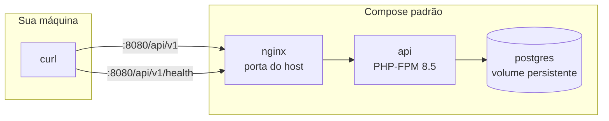

# 🛠️ Instalação e primeira execução

Este guia leva um checkout limpo até a API respondendo em `http://localhost:8080`.
Cada comando da sequência oficial é explicado linha a linha. Ao final, você sabe
o que cada passo fez, onde olhar quando algo falha e como confirmar a saúde da API.

---

## 📑 Índice

1. [Pré-requisitos](#️-pré-requisitos)
2. [Clonar e entrar no repositório](#-clonar-e-entrar-no-repositório)
3. [O arquivo `.env`](#-o-arquivo-env)
4. [A sequência oficial de setup](#-a-sequência-oficial-de-setup)
5. [Banco de desenvolvimento e saúde](#-banco-de-desenvolvimento-e-saúde)
6. [Alternativa: rodar no host](#-alternativa-rodar-no-host)
7. [Vários checkouts na mesma máquina](#-vários-checkouts-na-mesma-máquina)
8. [Quando algo dá errado](#-quando-algo-dá-errado)

---

## ✅ Pré-requisitos

| Requisito | Por que ele existe | Como confirmar |
| --- | --- | --- |
| Linux com Docker Engine | Os serviços (API, Nginx, PostgreSQL) rodam em containers | `docker info` responde sem erro |
| Plugin Docker Compose v2 | O `compose.yaml` da raiz orquestra todos os serviços | `docker compose version` mostra v2 |
| Python 3 | O script de configuração inicial do `.env` é um script Python | `python3 --version` |
| Acesso de rede | Baixar imagens Docker pinadas e pacotes Composer | `curl -sI https://github.com` responde |
| PHP 8.5 com `pdo_pgsql` e Composer 2 (opcional) | Só é necessário se você quiser rodar a suíte no host em vez de dentro do container | `php -v` mostra 8.5 e `php -m` lista `pdo_pgsql` |

O caminho recomendado usa PHP e Composer **dentro** dos containers. O PHP do host
não é utilizado nesse fluxo. O caminho com PHP no host existe como alternativa para
rodar a suíte de testes diretamente, e está descrito na seção 6.

---

## 📥 Clonar e entrar no repositório

### 1️⃣ Clonar

```bash
git clone <url-do-repositorio> starter-kit-api
cd starter-kit-api
```

Todos os comandos deste guia pressupõem a raiz do repositório como diretório atual,
porque os caminhos de volumes do `compose.yaml` (como `.` e `./public`) são relativos a ela.

---

## 🔑 O arquivo `.env`

O `.env` nunca é versionado. Ele guarda segredos locais descartáveis e ajustes de
porta. O modelo de todas as variáveis vive em `.env.example`. As variáveis que você
mais cedo ou mais tarde vai tocar:

| Variável | Significado | Valor local típico |
| --- | --- | --- |
| `APP_KEY` | Chave de criptografia de cookies e sessão, gerada pelo `key:generate` | preenchida pelo setup |
| `APP_URL` | URL pública da API, usada em links assinados de e-mail | `http://localhost:8080` |
| `HTTP_PORT` | Porta do host publicada pelo Nginx | `8080` |
| `FRONTEND_URL` | Origem do SPA em desenvolvimento | `http://localhost:5173` |
| `DB_PASSWORD` | Senha do PostgreSQL de desenvolvimento | aleatória, gerada pelo setup |
| `TEST_DB_PASSWORD` | Senha do PostgreSQL de teste | aleatória, gerada pelo setup |
| `CORS_ALLOWED_ORIGINS` | Origens exatas que o navegador pode usar com credenciais | `http://localhost:5173` |
| `SANCTUM_STATEFUL_DOMAINS` | Hosts que podem iniciar autenticação stateful | `localhost`, `127.0.0.1` e portas do SPA e da API |
| `SESSION_DOMAIN` | Domínio que recebe o cookie de sessão | vazio no desenvolvimento local |

> Em produção, `localhost` nunca é reutilizado: as variáveis `CORS_ALLOWED_ORIGINS`,
> `SESSION_DOMAIN` e `SANCTUM_STATEFUL_DOMAINS` recebem os domínios HTTPS reais,
> fornecidos pelo responsável pelo ambiente. A lista completa está em
> `docs/security-configuration.md`.

---

## 🚀 A sequência oficial de setup

### 1️⃣ Executar o setup

```bash
python3 scripts/setup_local_env.py
docker compose build api
docker compose run --rm --no-deps api composer install --no-interaction --prefer-dist
docker compose run --rm --no-deps api php artisan key:generate --no-interaction
docker compose up -d --wait
curl --fail http://localhost:8080/api/v1
curl --fail http://localhost:8080/up
```

### 2️⃣ Linha 1 — `python3 scripts/setup_local_env.py`

Cria o `.env` **uma única vez** a partir do `.env.example`. O script gera senhas
locais aleatórias e distintas para `DB_PASSWORD` e `TEST_DB_PASSWORD`, registra o
UID e o GID do seu usuário Linux para que os arquivos criados dentro do container
continuem pertencendo a você, e **se recusa a sobrescrever** um `.env` existente.
Nenhum segredo é impresso na tela. Se o comando disser que o `.env` já existe,
nada foi alterado: confira o arquivo atual em vez de forçar a recriação.

### 3️⃣ Linha 2 — `docker compose build api`

Constrói a imagem de desenvolvimento do serviço `api` (PHP-FPM 8.5 com as extensões
`mbstring`, `pdo_pgsql` e `zip`). É o momento em que o Docker baixa as camadas base.
Se a construção falhar por rede, repetir o comando retoma de onde parou.

### 4️⃣ Linha 3 — `composer install` no container efêmero

```bash
docker compose run --rm --no-deps api composer install --no-interaction --prefer-dist
```

Instala as dependências PHP **dentro** de um container efêmero do serviço `api`,
sem iniciar o banco (`--no-deps`) e removendo o container ao final (`--rm`).
O `--prefer-dist` baixa os pacotes como arquivos compactados, que é mais rápido que
clonar o código-fonte. O resultado é a pasta `vendor/` na raiz do checkout. Use esta
forma quando quiser garantir que a instalação use exatamente o PHP 8.5 da imagem.

### 5️⃣ Linha 4 — `key:generate` no container efêmero

```bash
docker compose run --rm --no-deps api php artisan key:generate --no-interaction
```

Gera a `APP_KEY` e a grava no `.env`. Sem essa chave, cookies de sessão não podem ser
assinados e a aplicação se recusa a autenticar. O `--no-interaction` impede qualquer
pergunta no meio do caminho. Se você apagar o `.env` por acidente, basta repetir as
linhas 1 e 4 para obter uma chave nova.

### 6️⃣ Linha 5 — `docker compose up -d --wait`

Sobe o conjunto padrão de desenvolvimento em segundo plano (`-d`): `api` (PHP-FPM),
`nginx` (proxy reverso na porta do host) e `postgres` (banco persistente). O `--wait`
faz o comando aguardar até que os healthchecks dos três serviços fiquem verdes:
o `api` responde na porta 9000 interna, o `nginx` serve `/up` e o `postgres` aceita
conexões. Se o comando retornar erro, `docker compose ps` mostra qual serviço não
ficou saudável, e `docker compose logs <serviço>` mostra o motivo.

### 7️⃣ Linha 6 — `curl --fail http://localhost:8080/api/v1`

Confirma que o versionamento da API responde. A resposta esperada é `{"status":"ok"}`.
Essa rota é a raiz do prefixo `api/v1` configurado no bootstrap da aplicação. Se ela
retornar o JSON, o caminho Nginx → PHP-FPM → Laravel está íntegro. Troque `8080` pela
porta definida em `HTTP_PORT` se você a alterou.

### 8️⃣ Linha 7 — `curl --fail http://localhost:8080/up`

Confirma que a aplicação inicializou, pelo endpoint `/up` do próprio framework.
A diferença para a linha anterior é importante: `/up` diz apenas que o Laravel subiu,
enquanto `/api/v1/health` (apresentado na seção 5) verifica cada dependência.

---

## 🩺 Banco de desenvolvimento e verificação de saúde

Com os serviços no ar, aplique as migrations e os dados de exemplo no banco de
desenvolvimento:

```bash
docker compose exec api php artisan migrate --seed --no-interaction
```

> O banco de desenvolvimento é persistente: vive no volume `postgres-dev` e sobrevive a
> `docker compose down`. Por isso, nunca use `migrate:fresh` nem `down --volumes` como
> rotina — ambos apagam dados locais. Em erro de autenticação no banco, compare o `.env`
> atual com as credenciais usadas quando o volume foi criado pela primeira vez; trocar a
> senha no `.env` depois do volume inicializado não atualiza o banco existente.

A prontidão operacional é pública e detalhada:

```bash
curl --fail http://localhost:8080/api/v1/health
```

Com tudo saudável, a resposta é HTTP 200 com o estado de cada verificação:

```json
{"status":"ok","checks":{"database":true,"redis":true,"queue":true}}
```

Se alguma dependência falhar, a resposta é HTTP 503 com o detalhe por verificação,
indicando exatamente onde olhar. A janela de falhas recentes de fila usa cinco minutos
por padrão e pode ser ajustada por `HEALTH_FAILED_JOBS_WINDOW_MINUTES`.



---

## 💻 Alternativa: rodar no host

Se o seu host já tem PHP 8.5 com `pdo_pgsql` e Composer 2, a suíte pode rodar fora do
Docker, desde que o banco de desenvolvimento esteja acessível pelos serviços subidos:

```bash
composer install
php artisan key:generate
composer test
```

Esse caminho exige as extensões corretas no host e não é o recomendado para o primeiro
setup. Em caso de divergência entre host e container, o resultado dentro do container
é o que vale.

---

## 🗂️ Vários checkouts na mesma máquina

O `compose.yaml` fixa o nome de projeto `starter-kit-api`. Dois checkouts rodando
`docker compose` sem nome explícito compartilham containers, rede e volume — e um
`down -v` num deles **destrói os dados do outro**. Com mais de um checkout na máquina,
sempre informe um nome único:

```bash
docker compose -p meu-checkout-local up -d --wait
```

> Nunca execute comandos destrutivos contra o nome compartilhado. O auxiliar
> `scripts/async_dev.sh` já impõe essa proteção para a pilha assíncrona.

---

## 🆘 Quando algo dá errado

| Sintoma | Causa provável | O que fazer |
| --- | --- | --- |
| `setup_local_env.py` diz que o `.env` já existe | Proteção contra sobrescrita | Revise o `.env` atual; apague-o conscientemente se quiser recomeçar |
| `DB_PASSWORD: Run the documented local environment setup first` | `.env` ausente ou sem as senhas | Rode a linha 1 do setup antes de qualquer comando Compose |
| Erro de senha no Postgres com volume antigo | Senha do `.env` diverge da usada na criação do volume | Recupere a senha original ou recrie o volume de forma deliberada |
| Arquivos gerados pertencem ao `root` | UID/GID desatualizados | Regenere só a configuração de UID/GID, sem trocar segredos |
| `/api/v1` responde mas `/api/v1/health` dá 503 | Dependência (banco, Redis, fila) indisponível | Leia o campo `checks` da resposta para saber qual |
| Porta 8080 ocupada | Outro serviço ou checkout usando a porta | Defina `HTTP_PORT` com valor livre no `.env` |
