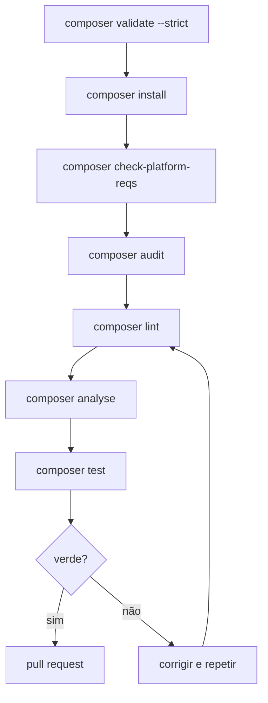
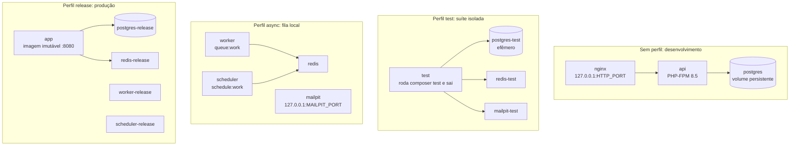
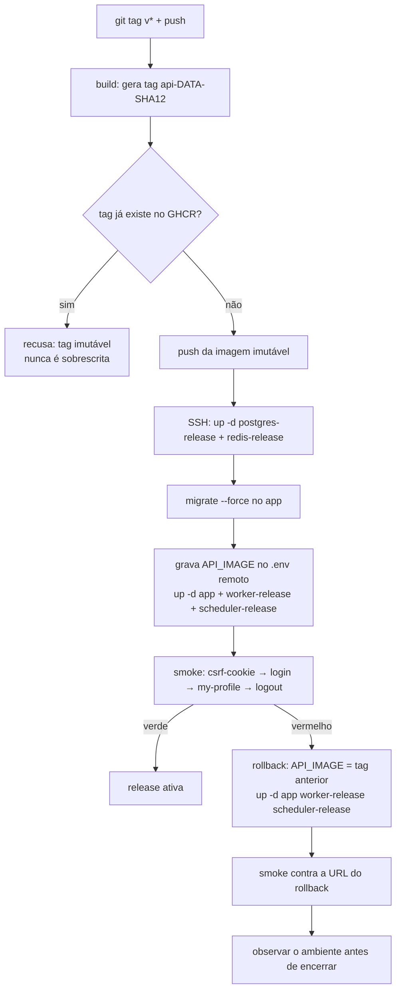

# 🧰 Comandos: Composer, Artisan e perfis do Compose

Este guia explica o que **cada comando faz e quando usar**. São três famílias:
scripts do Composer (qualidade e testes), comandos Artisan (operação da aplicação)
e perfis do Compose (quais serviços sobem em cada cenário). Comandos destrutivos
estão sinalizados.

---

## 📑 Índice

1. [Scripts do Composer](#️-scripts-do-composer)
2. [Artisan de banco de dados](#️-artisan-de-banco-de-dados)
3. [Artisan de operação e administração](#️-artisan-de-operação-e-administração)
4. [Artisan de diagnóstico](#️-artisan-de-diagnóstico)
5. [Perfis do Compose](#️-perfis-do-compose)
6. [Pipeline de release e rollback](#️-pipeline-de-release-e-rollback)

---

## 🎼 Scripts do Composer

Estão declarados em `composer.json`, na chave `scripts`. Todos rodam dentro do
container com `docker compose run --rm --no-deps api composer <script>`, ou no host
com `composer <script>` se o PHP local estiver correto.

| Script | Comando real | O que faz | Quando usar |
| --- | --- | --- | --- |
| `composer test` | `php vendor/bin/phpunit` | Executa a suíte PHPUnit contra PostgreSQL isolado | Após qualquer mudança de comportamento; é o sinal verde básico |
| `composer test:coverage` | duas execuções `phpunit --coverage-clover` (pgsql e sqlite) + `scripts/merge-coverage.php` + `scripts/coverage-floor.php` | Mede a união dos dois relatórios e exige o piso de **80%** das linhas | Antes de abrir um pull request; mesmo gate do CI |
| `composer lint` | `php vendor/bin/pint --test` | Verifica a formatação no preset `laravel` **sem alterar arquivos** | Antes de abrir um pull request; se falhar, rode o Pint sem `--test` localmente para aplicar |
| `composer analyse` | `php vendor/bin/phpstan analyse --memory-limit=512M` | Roda PHPStan com Larastan no nível 10 sobre aplicação, rotas e testes, sem linha de base de supressão | Antes de abrir um pull request; qualquer erro precisa ser corrigido, não suprimido |

### 1️⃣ Por que `test:coverage` executa a suíte duas vezes

Os caminhos de código mudam por driver: `app/Support/Filters/*` usa `ilike` no
PostgreSQL e `like` + `json_extract` no SQLite, `EmailLookup` e `LoginController`
montam predicados diferentes pelo mesmo motivo. Como cada ramo é exclusivo do seu
driver, nenhuma execução isolada alcança todas as linhas — daí a medição ser a **união**
de duas execuções. O script encadeia quatro etapas:

1. `php vendor/bin/phpunit --coverage-clover storage/app/coverage-pgsql.xml` — perna
   canônica (PostgreSQL, `phpunit.xml`); é o gate de aceitação, com zero falhas exigidas.
2. `php vendor/bin/phpunit -c phpunit.sqlite.xml --coverage-clover storage/app/coverage-sqlite.xml`
   — perna SQLite (`:memory:`), que mede os ramos do outro driver. O `phpunit.sqlite.xml`
   roda o testsuite `Feature` e exclui **por arquivo de teste** (lista documentada no
   próprio XML) os casos que só fazem sentido no ambiente pgsql/Compose — guardas de
   conexão, worker com Redis/Mailpit reais e servidor HTTP real. Nenhum código de `app/`
   é excluído do relatório (o `<source>` continua `app/`) e o `phpunit.xml` continua
   rodando todos os testes sob PostgreSQL.
3. `php scripts/merge-coverage.php storage/app/coverage-pgsql.xml storage/app/coverage-sqlite.xml storage/app/coverage.xml`
   — une os dois relatórios Clover por arquivo e linha (o maior `count` vence), sem
   encolher o denominador.
4. `php scripts/coverage-floor.php storage/app/coverage.xml 80` — lê o relatório
   unificado e sai com código 1 se as linhas cobertas ficarem abaixo do piso.

Para inspecionar uma perna isolada, rode as etapas 1 e 2 direto e passe o relatório
correspondente ao `coverage-floor.php` com o piso desejado como segundo argumento
(ex.: `php scripts/coverage-floor.php storage/app/coverage-sqlite.xml 90`).

Dois scripts são ganchos automáticos do Composer, não comandos do dia a dia:

- `post-autoload-dump` executa `artisan package:discover` após cada `composer install`
  ou `dump-autoload`, registrando os provedores dos pacotes. Você nunca o chama
  diretamente; se a aplicação disser que uma classe de pacote não existe após instalar
  dependências, rode `php artisan package:discover` manualmente.
- `pre-package-uninstall` prepara a remoção limpa de pacotes. Também é automático.

Três verificações usadas pelo CI não são scripts, mas comandos Composer diretos que
valem a pena conhecer:

| Comando | O que faz | Quando usar |
| --- | --- | --- |
| `composer validate --strict` | Confere se `composer.json` e `composer.lock` estão consistentes | Após editar dependências manualmente |
| `composer check-platform-reqs` | Confere se o PHP e as extensões atendem ao declarado | Ao trocar de imagem PHP ou ver falhas de extensão |
| `composer audit` | Procura vulnerabilidades conhecidas nas dependências instaladas | Regularmente e antes de releases |

---

## 🗄️ Artisan de banco de dados

| Comando | O que faz | Quando usar |
| --- | --- | --- |
| `php artisan migrate --seed` | Aplica migrations pendentes e popula dados de exemplo no banco de desenvolvimento | Após o setup inicial e após puxar migrations novas |
| `php artisan migrate --force` | Aplica migrations sem pedir confirmação | **Somente** em ambientes não interativos (release, CI); em dev, prefira sem `--force` |
| `php artisan migrate:rollback` | Desfaz o último lote de migrations | Para testar reversibilidade local de uma migration nova |
| `php artisan migrate:refresh` | Desfaz e reaplica todas as migrations | Apenas em banco descartável; **nunca** no desenvolvimento com dados |
| `php artisan migrate:fresh` | Apaga todas as tabelas e reaplica tudo do zero | **Proibido** fora de contextos efêmeros; apaga dados locais |
| `php artisan db:seed` | Roda os seeders sem mexer no esquema | Para repopular dados de exemplo após limpar tabelas manualmente |
| `php artisan db:show` | Mostra informações do banco conectado | Para confirmar a qual banco você está apontado antes de um comando sensível |

> Regra de ouro: antes de qualquer comando de escrita no banco, confirme o alvo com
> `db:show`. O banco de desenvolvimento é persistente em volume; o de teste é efêmero.

---

## ⚙️ Artisan de operação e administração

| Comando | O que faz | Quando usar |
| --- | --- | --- |
| `php artisan key:generate` | Gera a `APP_KEY` no `.env` | Uma vez por ambiente novo; sem ela não há sessão |
| `php artisan app:promote-admin {id}` | Promove a conta indicada a administradora, de forma transacional, idempotente e auditada | Para criar o **primeiro** administrador; exige conta existente, verificada e ativa |
| `php artisan app:promote-admin {id} --confirm-production` | Variante que autoriza explicitamente o bootstrap em produção | Somente no ambiente de produção, com aprovação humana |
| `php artisan queue:work database --queue=default --tries=3 --backoff=5,15,60 --max-jobs=100 --max-time=3600` | Consome a fila do banco: 3 tentativas com espera progressiva, até 100 jobs ou 1 hora | Worker avulso sem o perfil `async`; em dev com Redis e Mailpit, prefira o perfil |
| `php artisan schedule:work` | Executa o agendador (dispara os comandos diários na hora certa) | Scheduler avulso; em dev com a pilha completa, prefira o perfil `async` |
| `php artisan auth:prune-expired-tokens` | Remove tokens de redefinição expirados e contas não verificadas com mais de 24 horas | Roda diariamente via agendamento; uso manual só para inspeção |
| `php artisan queue:prune-failed --hours=168` | Remove jobs falhados com mais de sete dias | Roda diariamente; uso manual só para inspeção |
| `php artisan activitylog:clean` | Aplica a retenção de 90 dias da trilha de auditoria | Roda diariamente; uso manual só para inspeção |
| `php artisan scramble:export --path=<arquivo>` | Exporta o contrato OpenAPI gerado a partir das rotas | Somente para inspeção local; o snapshot oficial é produzido pelo workflow próprio na `main` |

O `app:promote-admin` merece atenção especial: ele é o **único** caminho de bootstrap
administrativo. Não existem credenciais fixas, promoção do primeiro cadastro nem seed
de admin em produção. Se a conta já for administradora, nada é alterado. Se a gravação
da auditoria falhar, a promoção é revertida junto.

---

## 🩺 Artisan de diagnóstico

| Comando | O que faz | Quando usar |
| --- | --- | --- |
| `php artisan infra:probe --key=<chave>` | Grava um marcador efêmero e confirma conectividade com a infraestrutura | É o que os healthchecks do worker e do scheduler executam; use para testar Redis manualmente |
| `php artisan infra:fail-job` | Enfileira um job sintético que falha, para exercitar retry, backoff e `failed_jobs` | Para testar o caminho de falha da fila em desenvolvimento |
| `php artisan infra:smoke-mail` | Enfileira um e-mail sintético pela pilha assíncrona | Para testar entrega via Mailpit em desenvolvimento |
| `php artisan cache:clear` | Limpa o cache da aplicação | Quando comportamento estranho sugere cache obsoleto |
| `php artisan config:clear` / `config:cache` | Remove / reconstrói o cache de configuração | Após alterar `.env` com cache ativo; `clear` em dev, `cache` em release |

> Os comandos `infra:*` são exclusivos de desenvolvimento e nunca vão para produção.

---

## 🐳 Perfis do Compose

O `compose.yaml` organiza os serviços em perfis. Sem `--profile`, sobem apenas os
serviços do desenvolvimento padrão.

| Perfil | Serviços adicionados | Comando típico | Quando usar |
| --- | --- | --- | --- |
| (nenhum) | `api`, `nginx`, `postgres` | `docker compose up -d --wait` | Desenvolvimento diário |
| `test` | `test`, `postgres-test`, `redis-test`, `mailpit-test` | `docker compose --profile test run --rm test` | Rodar a suíte PHPUnit isolada, igual ao CI, sem instalar nada no host |
| `async` | `redis`, `mailpit`, `worker`, `scheduler` | `docker compose --profile async up -d worker scheduler` | Desenvolver com fila, e-mails e agendamento reais |
| `release` | `app`, `worker-release`, `scheduler-release`, `postgres-release`, `redis-release` | `docker compose --profile release up -d` | Simular a pilha de produção com imagem imutável |

Detalhes que evitam surpresas:

- O perfil `test` usa rede interna isolada, credenciais próprias e armazenamento
  temporário: a suíte nunca alcança o banco de desenvolvimento e nunca publica portas
  no host. É o caminho recomendado para obter o `composer test` verde do zero.
- O perfil `async` é exclusivo de desenvolvimento: o worker e o scheduler reiniciam
  sozinhos e seus healthchecks provam apenas conectividade, não processamento real.
  Produção monitora profundidade e atraso da fila em vez disso.
- O perfil `release` exige `API_IMAGE` apontando para uma tag imutável
  `api-<data>-<sha>` e segredos fora do Git (`APP_KEY`, `APP_URL`,
  `RELEASE_DB_CREDENTIAL`). O healthcheck do `app` consulta `GET /api/v1/health`.
- Com múltiplos checkouts na máquina, adicione `-p <nome-unico>` a qualquer comando
  acima, porque o nome de projeto padrão é compartilhado. Nunca rode `down --volumes`
  contra o projeto compartilhado.

---

## 🚢 Pipeline de release e rollback

A tag Git `v*` é só o gatilho: o workflow de deploy (`.github/workflows/deploy.yml`)
gera a tag imutável `api-<data>-<sha>` (`api-$(date -u +%Y%m%d)-${GITHUB_SHA::12}`),
recusa sobrescrever uma tag que já exista no GHCR, publica a imagem, atualiza o host
via SSH (`API_IMAGE` + `migrate --force` + `up -d`) e roda o smoke reutilizável
(`.github/workflows/smoke.yml`).

> Para o rollback, aponte `API_IMAGE` no `.env` do host para a tag imutável anterior
> e suba só `app worker-release scheduler-release`. Rode o smoke contra a URL do
> rollback e observe o ambiente antes de encerrar. Nunca apague volumes de banco no
> deploy nem no rollback — migration sem compatibilidade retroativa exige um plano de
> rollback de dados aprovado à parte. O passo a passo completo está em
> [`release.md`](release.md).
