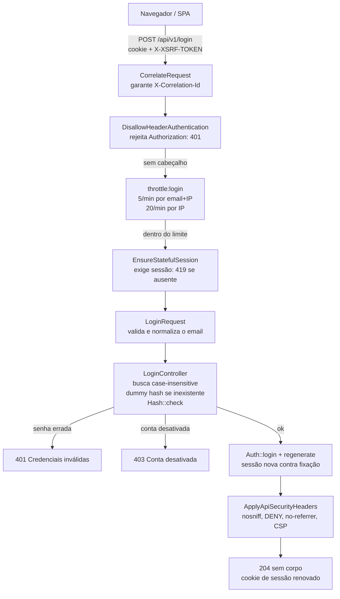
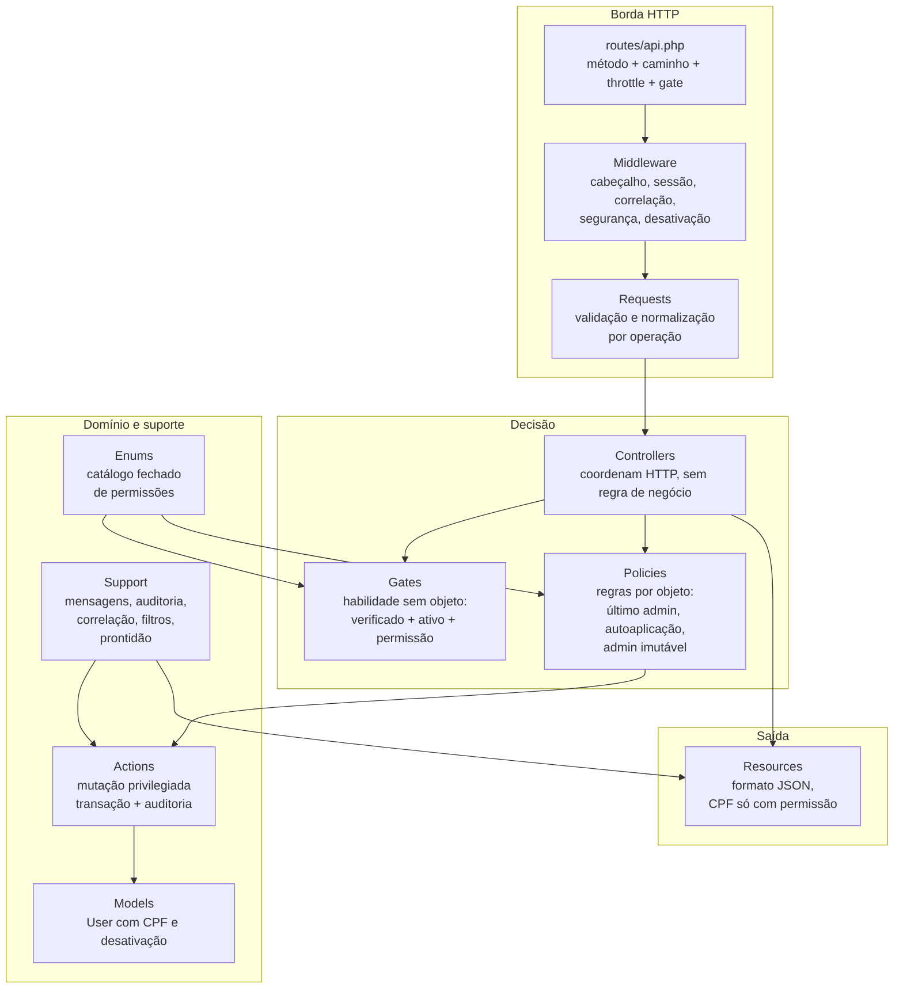
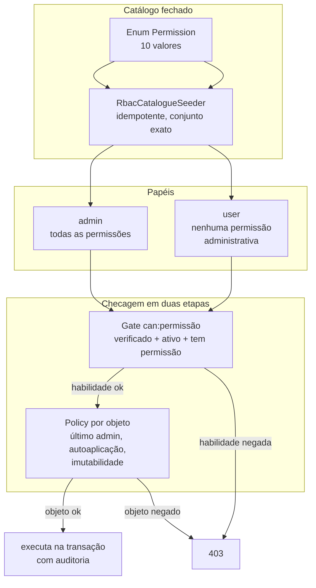
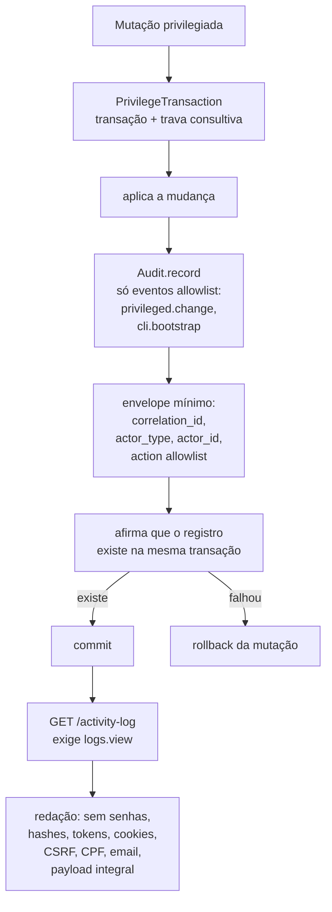

# 03 — Arquitetura: requisição, camadas, RBAC e auditoria

Este guia explica como uma requisição atravessa a API, o que mora em cada camada do
código, como a autorização decide quem pode o quê e como a auditoria registra o que
foi decidido. Os quatro desenhos usam Mermaid e acompanham o código real em
`routes/api.php`, `bootstrap/app.php`, `app/Policies`, `app/Support` e nos enums de
catálogo.

## 1. Ciclo de vida de uma requisição: o login como exemplo

Toda a API vive sob o prefixo `api/v1`, configurado no bootstrap. Antes de qualquer
controller, dois middlewares globais sempre executam: `CorrelateRequest`, que garante
um identificador de correlação na requisição e na resposta, e
`ApplyApiSecurityHeaders`, que aplica os cabeçalhos de segurança em respostas `api/*`.
O exemplo abaixo segue um `POST /api/v1/login` camada por camada.

Cada parada tem um motivo:

- **Correlação primeiro.** O `CorrelateRequest` é o middleware mais externo, então o
  identificador acompanha a requisição do início ao fim e volta no cabeçalho da
  resposta. Em ambientes locais, um valor válido enviado pelo cliente é respeitado;
  qualquer outra coisa é substituída por um UUID novo, para que nada arbitrário vire
  registro de log.
- **Bloqueio de cabeçalho antes de tudo.** O `DisallowHeaderAuthentication` roda antes
  da autenticação do framework e aborta com 401 qualquer requisição que traga
  `Authorization`. É assim que a API garante que tokens nunca funcionem como
  credencial, mesmo que o pacote Sanctum os conheça.
- **Throttle antes do controller.** O limitador `login` permite 5 tentativas por minuto
  por combinação de e-mail e IP, mais um teto de 20 por minuto por IP. A chave usa o
  hash SHA-256 do e-mail normalizado com o IP, então o endereço nunca aparece na chave
  de cache. Estourar o limite responde 429 com mensagem padronizada.
- **Sessão stateful exigida.** O `EnsureStatefulSession` aborta com 419 quando não há
  sessão, o que acontece se o cliente pulou o `GET /sanctum/csrf-cookie`. Essa é a
  falha típica de integrações novas: sem cookie XSRF prévio, o login nunca chega ao
  controller.
- **Busca que não entrega existência.** O controller normaliza o e-mail para
  minúsculas sem espaços e busca de forma case-insensitive. Se o usuário não existe,
  ele ainda executa `Hash::check` contra um hash falso (dummy hash) e responde o mesmo
  401 genérico. O tempo de resposta fica parecido nos dois casos, e a mensagem nunca
  revela se o e-mail está cadastrado.
- **Sessão regenerada.** Após autenticar, o ID da sessão é regenerado, o que impede
  fixação de sessão: um identificador obtido antes do login deixa de valer depois.

Rotas autenticadas trocam o trecho central do desenho: em vez de throttle de login e
`EnsureStatefulSession`, entra `auth:sanctum` (exige sessão válida), seguido do gate
`can:<permissão>` da operação e, nas mutações, da policy por objeto dentro de uma
transação de privilégio. O perfil próprio (`GET /auth/my-profile`) ainda passa por
`EnsureAccountNotDeactivated`, que responde 403 para contas desativadas mesmo com
sessão válida.

## 2. As camadas e o que mora em cada uma

A regra de separação é simples de aplicar na prática:

- **Requests** validam e normalizam a entrada na borda (formato de e-mail, senha
  mínima de 12 caracteres, filtros `search`/`status`/`role`, paginação limitada a 100
  itens). O método `authorize()` de cada request aplica o gate da habilidade.
- **Controllers** coordenam HTTP: recebem o request validado, chamam a decisão e
  devolvem o resource. Regra de negócio dentro de controller é exceção, não padrão.
- **Gates** decidem habilidades sem objeto, como listar usuários: exigem e-mail
  verificado, conta ativa e a permissão do catálogo. Cada permissão do enum vira um
  gate registrado no `AppServiceProvider`.
- **Policies** decidem sobre objetos específicos: um ator pode editar *este* usuário?
  Pode desativar *esta* conta? É aqui que vivem as proteções de último administrador,
  anti-autoaplicação e imutabilidade do papel `admin`.
- **Actions** executam mutações privilegiadas dentro de `PrivilegeTransaction`: a
  operação e o evento de auditoria são confirmados no mesmo commit, e qualquer falha
  reverte tudo.
- **Resources** controlam o JSON de saída. O `UserResource` expõe o CPF somente quando
  o ator tem a permissão de leitura para aquele alvo; nos demais casos o campo nem
  aparece. Datas saem em UTC no formato `Y-m-d\TH:i:s\Z`.
- **Support** concentra comportamento transversal: vocabulário de mensagens de erro,
  escritor de auditoria, correlação, filtros de listagem com allowlist e verificações
  de prontidão usadas pelo healthcheck.

Erros seguem o catálogo central de mensagens: autenticação ausente é 401, falta de
permissão é 403, validação é 422 com detalhe por campo, e falhas inesperadas são 500
com mensagem genérica quando o debug está desligado — nunca com detalhes internos.

## 3. O RBAC na prática

O catálogo de permissões é fechado: vive num enum e é provisionado por seeder
idempotente. A API administra usuários e papéis, inclusive atribuindo permissões
existentes a papéis, mas nunca cria nem remove definições de permissão por HTTP. Uma
capacidade nova exige mudança de código revisada.

As dez permissões e o que cada uma autoriza:

| Permissão | Autoriza | Proteção de objeto |
| --- | --- | --- |
| `users.manage` | Criar e remover contas | Sem autoexclusão; preserva o último admin ativo |
| `users.view` | Listar e ver contas | Nenhuma (gate) |
| `users.update` | Editar atributos básicos | Nenhuma além do gate |
| `users.set-status` | Ativar e desativar contas | Sem autodesativação; desativar admin exige outro admin ativo |
| `users.assign-roles` | Substituir os papéis do alvo | Sem autoatribuição; preserva o último admin ativo |
| `users.read-cpf` | Ler o CPF do alvo | O titular lê o próprio; gestão só com a permissão |
| `roles.view` | Listar e ver papéis | Nenhuma (gate) |
| `roles.update-permissions` | Reescrever permissões de um papel | O papel `admin` é imutável |
| `roles.manage` | Criar e remover papéis | Remoção negada com o papel atribuído a alguém |
| `logs.view` | Listar a trilha de auditoria | Nenhuma (gate) |

Três invariantes sustentam o desenho. Primeiro, elegibilidade: todo ator administrativo
precisa estar verificado e ativo, independentemente de papéis — permissão sozinha nunca
basta. Segundo, último administrador em pé: remover a role `admin` ou desativar um
admin é negado quando nenhum outro admin ativo permanece, e conta desativada nunca
conta como em pé. Terceiro, concorrência: mutações de privilégio rodam sob trava
consultiva do PostgreSQL, então duas remoções simultâneas do último admin não passam
juntas pela verificação.

## 4. A auditoria e seu envelope mínimo

A trilha usa o Activitylog como único mecanismo inicial. Nem todo modelo nem todo
request é auditado: só eventos aprovados (mudanças de privilégio e bootstrap
administrativo), com envelope mínimo e allowlist explícita de atributos.

O que o desenho garante, ponto a ponto:

- **Fail-closed.** O evento é gravado na mesma transação da operação e sua existência
  é verificada antes do commit. Se a gravação falha, a mutação é revertida: nunca
  existe privilégio concedido sem registro correspondente.
- **Envelope mínimo por negação padrão.** Só sobrevivem as chaves aprovadas
  (`correlation_id`, `actor_type`, `actor_id`, `action`); todo o resto é descartado. Senhas,
  hashes, tokens, cookies, CSRF, CPF, e-mail e payload integral são proibidos, e IP
  não é coletado por padrão.
- **Ação específica e validada.** `event` agrupa mudanças privilegiadas e bootstrap;
  `properties.action` identifica a operação com um código da allowlist, como
  `user.store`, `user.status`, `role.update_permissions` ou `admin.bootstrap`. O feed
  aceita `?action=<código aprovado>` e rejeita códigos fora da lista.
- **Leitura controlada.** A trilha não pode ser editada nem removida pela API, e a
  leitura exige a permissão `logs.view`. A limpeza após 90 dias é restrita ao processo
  operacional agendado (`activitylog:clean`), nunca a um endpoint.
- **Filtro por ação.** `GET /api/v1/activity-log?action=<código>` aceita apenas um
  dos códigos de operação aprovados; `event` continua disponível para filtrar a
  categoria ampla da atividade.
- **Retenção declarada.** Eventos vivem 90 dias. Classificação fina, responsabilidades
  operacionais e tratamento em backups são definidos antes da coleta em produção.
