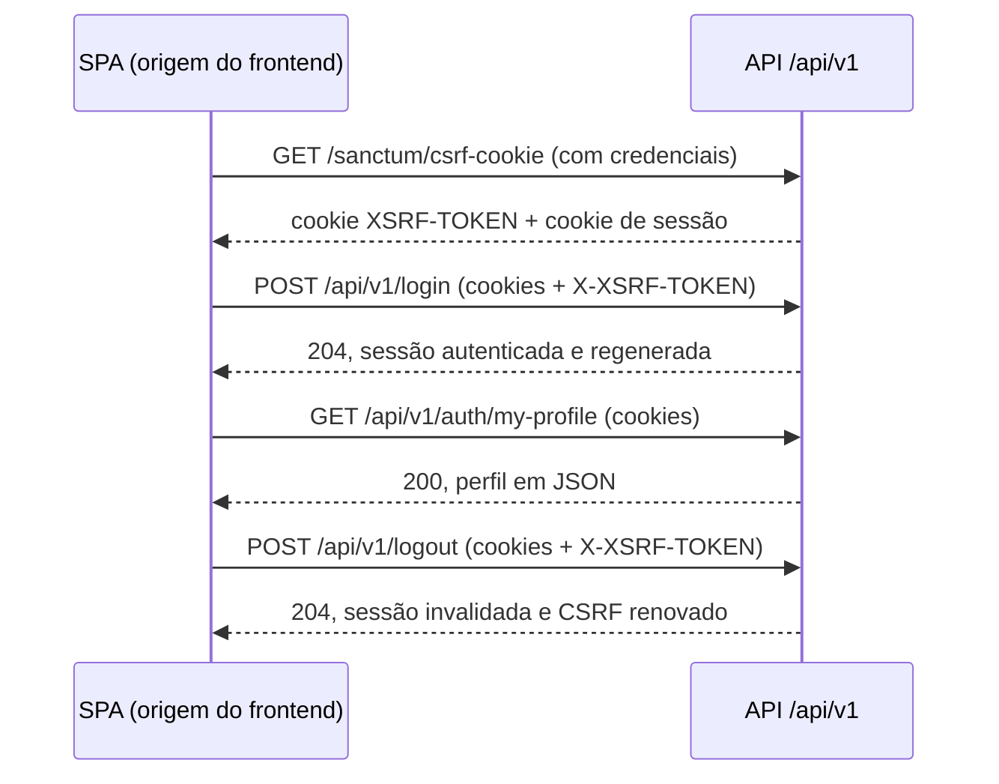
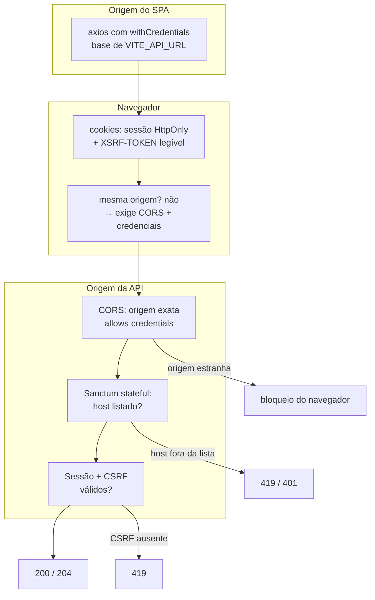

# 05 — Integração fullstack: SPA, sessão, CORS e contrato

Este guia explica como o SPA consome a API como origem independente usando a mesma
sessão em cookie, o que cada lado precisa configurar para o navegador permitir isso
e como o contrato OpenAPI pinado mantém os dois repositórios sincronizados. É a
leitura para quem desenvolve o frontend ou depura falhas de autenticação entre
origens.

## 1. A sequência completa no navegador

O frontend nunca envia credenciais por cabeçalho: ele trabalha com a sessão em
cookie emitida pela API, com CSRF validado a cada mutação. A ordem é rígida — cada
passo depende do anterior.

Lendo a sequência:

- **O CSRF vem primeiro.** Antes da primeira chamada autenticada, o SPA requisita
  `GET /sanctum/csrf-cookie`. A resposta planta dois cookies: o `XSRF-TOKEN`, legível
  pelo JavaScript, e o de sessão, `HttpOnly`. Pular essa chamada é a causa mais comum
  de 419: sem sessão prévia, o login é abortado antes do controller.
- **Mutação leva token.** `POST /login` e `POST /logout` enviam os cookies junto com
  o cabeçalho `X-XSRF-TOKEN`. Leitura (`GET /auth/my-profile`) envia só os cookies.
- **401 volta ao login, 403 vai ao "/403".** As guardas de rota do SPA tratam os dois
  códigos separadamente: sessão ausente ou expirada manda de volta ao login; sessão
  válida sem permissão leva à página dedicada de acesso negado. Testes cobrem ambos.
- **Logout encerra de verdade.** A sessão é invalidada no servidor e o CSRF é
  renovado, então reutilizar cookies antigos depois do logout não autentica ninguém.

## 2. CORS stateful: o acordo entre as origens

Em desenvolvimento, o Vite serve o SPA em `http://localhost:5173` enquanto a API
escuta em outra porta — origens diferentes para o navegador. Três variáveis, uma de
cada lado do acordo, precisam concordar:

| Variável (lado API) | O que declara | Valor local |
| --- | --- | --- |
| `CORS_ALLOWED_ORIGINS` | Origens HTTPS exatas autorizadas, com credenciais | `http://localhost:5173` |
| `SANCTUM_STATEFUL_DOMAINS` | Hosts e portas que podem iniciar autenticação stateful, sem esquema | `localhost`, `127.0.0.1` e portas do SPA e da API |
| `SESSION_DOMAIN` | Domínio compartilhado que recebe o cookie de sessão | Vazio no desenvolvimento; domínio pai comum em produção |

Regras que valem sempre:

- **Sem curinga.** Origens são exatas, incluindo esquema e porta quando aplicável.
  Curinga com credenciais é recusado por desenho.
- **`supports_credentials` só para as origens exatas.** É o que permite ao navegador
  enviar cookies, e só funciona contra origens listadas.
- **Produção usa domínios reais.** Quando API e SPA passam a compartilhar um domínio
  pai, `SESSION_DOMAIN` recebe esse domínio para que o mesmo cookie valha nas duas
  pontas, com cookie seguro e `SameSite` ajustados ao contexto HTTPS. Os valores
  `localhost` nunca são reutilizados em produção. O perfil completo dos atributos
  (`SESSION_SECURE_COOKIE`, `SESSION_HTTP_ONLY`, `SESSION_SAME_SITE`) está
  documentado em `docs/security-configuration.md`.

## 3. `VITE_API_URL`: a única ponte de endereço

O cliente HTTP do SPA cria a instância axios com `withCredentials` habilitado,
configurada a partir de `VITE_API_URL`. Essa variável aponta para a **raiz da API,
sem caminho e sem barra final** — por exemplo, `http://localhost:8080` no
desenvolvimento. Todos os caminhos (`/sanctum/csrf-cookie`, `/api/v1/login`, ...) são
anexados a essa base pelo cliente centralizado, que também injeta o `X-XSRF-TOKEN` nas
mutações. Trocar de ambiente é trocar essa variável, nunca espalhar URLs pelo código.

## 4. Contrato OpenAPI pinado gerando tipos

O snapshot `contracts/openapi.json` (OpenAPI 3.1.0, versão vinda de `API_VERSION`) é
a fonte canônica do formato de cada endpoint: entradas, respostas, erros e
autenticação. O repositório do frontend gera seus tipos TypeScript a partir desse
arquivo pinado, com saída para cliente sobre axios e mutador centralizando base URL,
credenciais e CSRF. Os arquivos gerados carregam cabeçalho de procedência e nunca são
editados manualmente: regenera-se por comando e verifica-se a sincronia por comando
próprio.

O snapshot entra no repositório por fluxo controlado: após integrar mudanças de rotas
ou contratos na `main`, o produtor exporta o contrato duas vezes para provar
determinismo (bytes idênticos), publica o artefato versionado e o snapshot é atualizado
em commit próprio após revisão. O gate de contrato do CI confirma que o snapshot
commitado corresponde ao contrato atual. Exportações locais servem para inspeção, não
substituem o produtor oficial.

## 5. Quando o contrato muda: o que cada lado faz

| Tipo de mudança | Lado API | Lado SPA |
| --- | --- | --- |
| Campo ou endpoint novo opcional | Implementa sob `/api/v1`, atualiza o snapshot | Regenera tipos; nada quebra se não usar |
| Campo obrigatório novo ou remoção | **Proibido** sob `/api/v1` | — |
| Mudança incompatível real | Novo prefixo `/api/v2` com convivência do v1 | Migra no ritmo próprio, com tipos gerados do v2 |
| Novo código de erro ou permissão | Documenta no contrato e no snapshot | Ajusta guardas de rota (401 → login, 403 → "/403") |

A ordem nunca inverte: primeiro a API versiona e publica o snapshot revisado, depois
o SPA regenera os tipos contra o arquivo pinado. Mudança de contrato sem snapshot
atualizado é mudança pela metade — o CI barra, e é para barrar mesmo.
