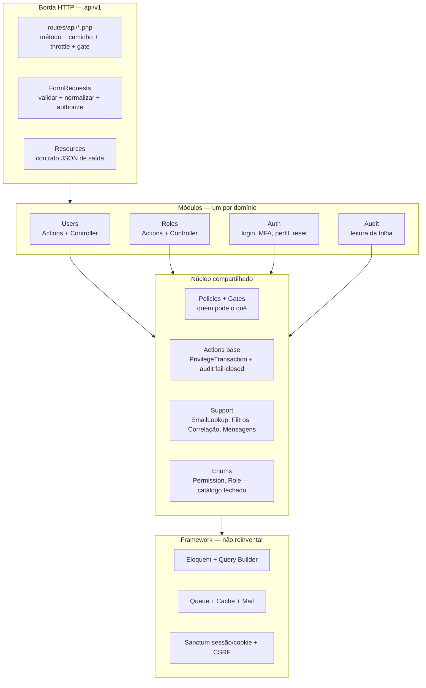
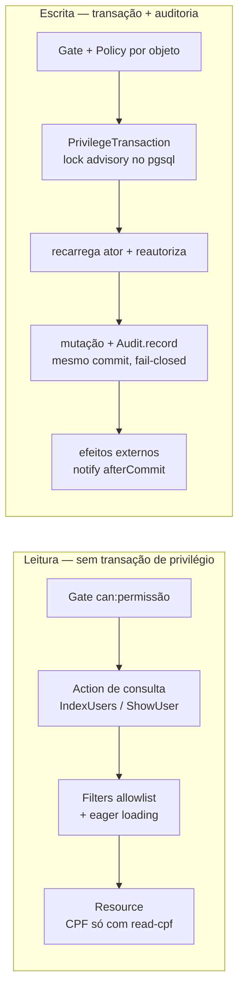
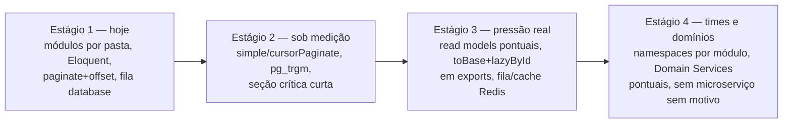

# 🏗️ Arquitetura do código e escala sem reescrita

Como a aplicação é montada em código hoje e como ela cresce por estágios —
**nível de código, não infraestrutura**. O ciclo de vida de uma requisição está em
[03-arquitetura](03-arquitetura.md); os vereditos de padrões e os gatilhos, em
[06-padroes](06-padroes.md). Aqui estão os desenhos.

## 📑 Índice

1. [Arquitetura estática: módulos e núcleo](#-arquitetura-estática-módulos-e-núcleo)
2. [Leitura vs escrita: os dois caminhos](#-leitura-vs-escrita-os-dois-caminhos)
3. [Escala em estágios: o que muda no código](#-escala-em-estágios-o-que-muda-no-código)

---

## 🧩 Arquitetura estática: módulos e núcleo

Três módulos de negócio verticais sobre um núcleo compartilhado, sobre o
framework. Dependência só desce: módulo nunca importa módulo.

Regras do desenho: recurso novo = módulo novo repetindo o molde (receita A em
[07-receitas-de-features](07-receitas-de-features.md)); regra transversal = núcleo;
o que o framework dá (ORM, fila, cache, sessão) não se reimplementa.

## 🔀 Leitura vs escrita: os dois caminhos

A separação é o CQRS leve que já existe: consultas nunca tocam trava nem
auditoria; mutações nunca escapam das duas.

## 📈 Escala em estágios: o que muda no código

O que **muda** por estágio: S1→S2 é consulta e paginação (contrato de metadados
pode mudar — ver 06); S2→S3 é trecho quente provado por perfil, nunca a camada;
S3→S4 é organização para gente, não para máquina. O que **não muda** em nenhum
estágio: contrato v1 aditivo, auditoria fail-closed, policies por objeto,
catálogo fechado de permissões, `afterCommit` nos efeitos externos.

Cada transição é um PR próprio com medição antes/depois; o detalhamento dos
gatilhos está em [06-padroes](06-padroes.md#escalabilidade-e-performance-gatilhos-não-previsões).
